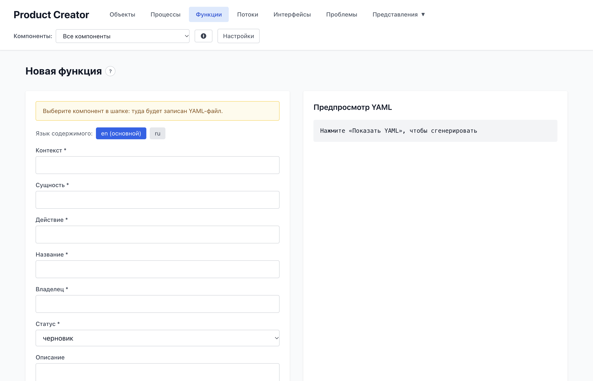
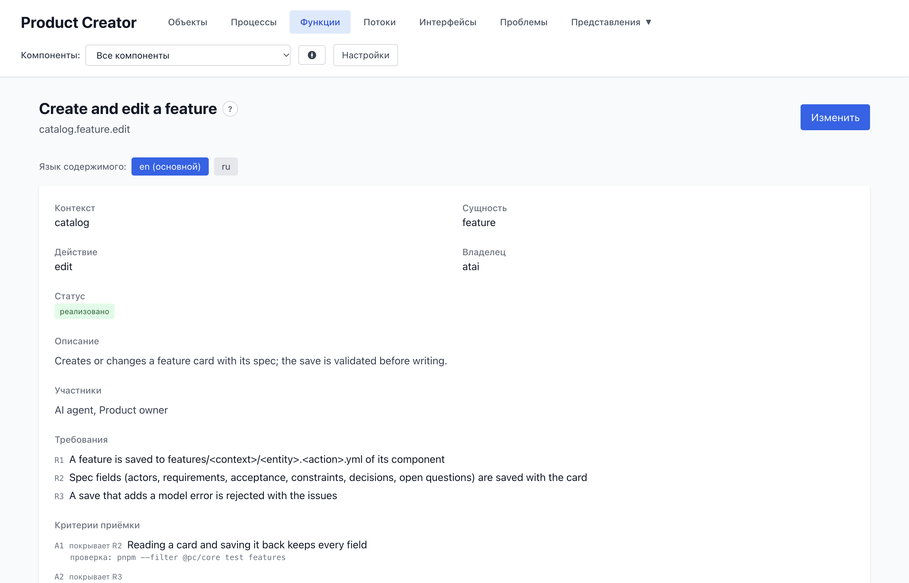
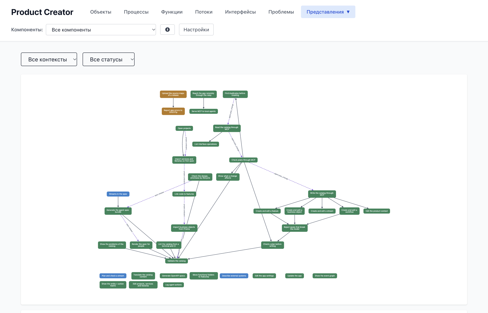
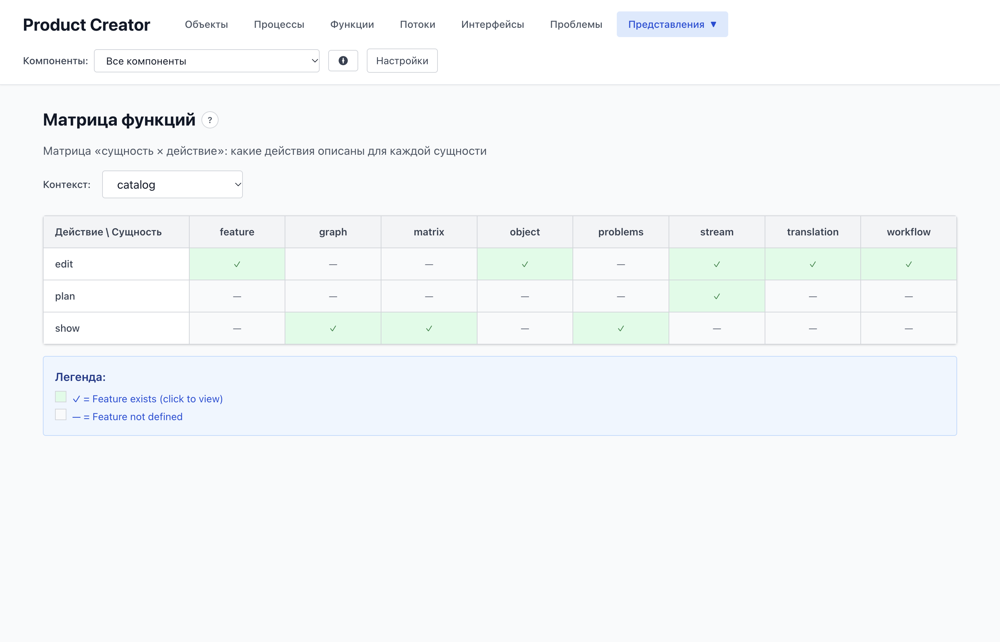
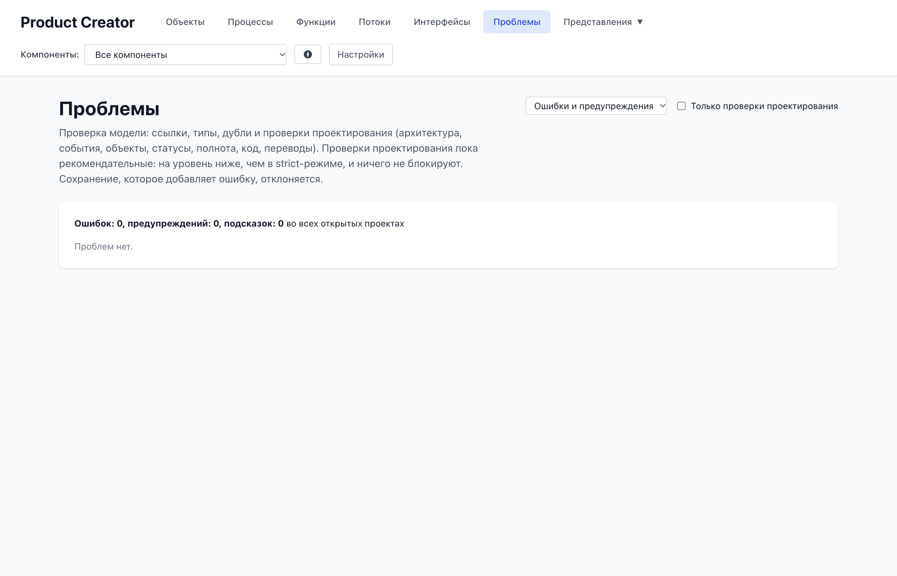
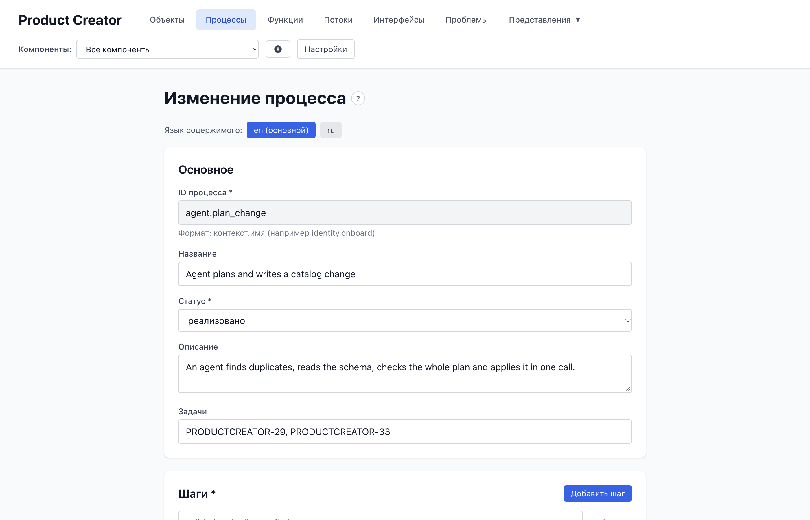
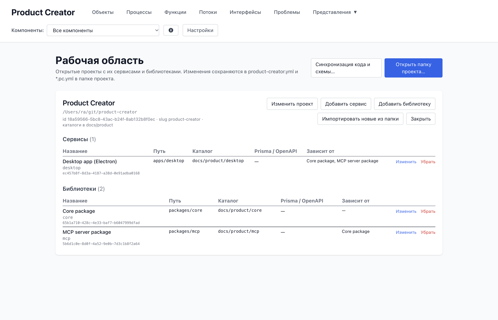
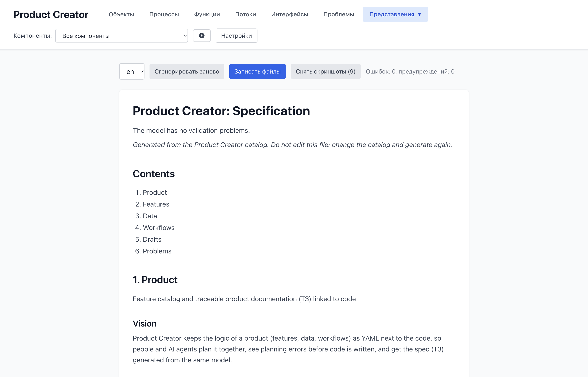

# Product Creator: Техническое задание

Ошибок и предупреждений нет; 1 подсказ(ок) по проектированию в разделе «Проблемы».

*Сгенерировано из каталога Product Creator. Не редактируйте этот файл: измените каталог и сгенерируйте заново.*

*268 текст(ов) ещё не переведены и показаны на основном языке (en), с пометкой EN.*

## Содержание

1. Продукт
2. Фичи
3. Данные
4. Процессы
5. Потоки
6. Черновики
7. Проблемы

## 1. Продукт

Каталог фич и прослеживаемая документация продукта (ТЗ), связанная с кодом

### Видение

Product Creator хранит логику продукта (фичи, данные, процессы) в YAML рядом с кодом, чтобы люди и ИИ-агенты планировали её вместе, видели ошибки планирования до написания кода и получали ТЗ из той же модели.

### Цели

- **G1** Ошибки планирования и проектирования видны людям и агентам сразу, как только они записаны: в редакторе, через MCP и в CI
- **G2** ТЗ для людей и для агентов строятся из одной модели и никогда не пишутся дважды
- **G3** Каждая фича прослеживается до кода, задач и тестов
- **G4** Агенты безопасно планируют и меняют каталог через MCP

### Участники

| Участник | Описание |
| --- | --- |
| Владелец продукта | Планирует фичи, утверждает ТЗ |
| Разработчик | Делает фичи, связывает код, запускает синхронизацию |
| ИИ-агент | Читает и меняет каталог через MCP, локально или через релей |
| CI | Проверяет каталог при каждом push |
| Заказчик | Читает ТЗ для людей |

### Внешние системы

| Система | Описание | Публикует события | Обрабатывает события |
| --- | --- | --- | --- |
| GlitchTip | Self-hosted трекер ошибок ecooz (протокол Sentry), error.y.ecooz.net | `glitchtip.issue.created` | `app.error.reported`, `app.sourcemaps.uploaded` |
| YouTrack | Трекер задач проекта (ecooz.youtrack.cloud) | `youtrack.issue.created` | `glitchtip.issue.created` |
| GitHub | Исходный код, CI и релизы, из которых обновляется приложение | `github.release.published` | `youtrack.issue.created` |

### Глоссарий

| Термин | Определение |
| --- | --- |
| Feature | Бизнес-возможность продукта (раньше — function); один YAML-файл с её ТЗ и связями с кодом |
| Business object | Сущность данных продукта с типизированными полями |
| Workflow | Упорядоченная последовательность фич с компенсациями |
| Component | Сервис или библиотека проекта; у каждого своя папка каталога |
| Catalog | YAML-файлы фич, бизнес-объектов и процессов компонента |
| Lifecycle | draft → approved → implemented → deprecated → removed; у каждого статуса свои правила |
| Plan | Набор предлагаемых изменений каталога, который проверяется целиком до записи |
| Spec (ТЗ) | Документ, построенный по модели: вид для людей и пакет для агентов |

## 2. Фичи

### app

#### Edit the app settings [EN] (`app.settings.edit`)

*реализовано* · Компонент: Desktop app (Electron) · Задачи: [PRODUCTCREATOR-18](https://ecooz.youtrack.cloud/issue/PRODUCTCREATOR-18), [PRODUCTCREATOR-20](https://ecooz.youtrack.cloud/issue/PRODUCTCREATOR-20)

Settings: run the MCP server, its scope, port and token; remote access through the relay. [EN]

**Участники:** Владелец продукта, Разработчик

**Требования**

- **R1** The token is generated once and kept in the app data folder (mode 0600) [EN]
- **R2** Changing scope or token ends the open agent sessions [EN]

**Критерии приёмки**

- **A1** (покрывает R1): SettingsStore generates, keeps and regenerates the token [EN]
- **A2** (покрывает R2): A token change ends local sessions [EN]

**Бизнес-объекты:** `mcp_settings` (запись)

#### Update the app [EN] (`app.update.install`)

*реализовано* · Компонент: Desktop app (Electron) · Задачи: [PRODUCTCREATOR-21](https://ecooz.youtrack.cloud/issue/PRODUCTCREATOR-21)

Signed releases update automatically; a check can be started from the menu. [EN]

**Участники:** Владелец продукта

**Требования**

- **R1** Only a packaged build updates itself: not in dev, not in smoke runs, not with PC_DISABLE_AUTO_UPDATE, on Linux only the AppImage [EN]

**Критерии приёмки**

- **A1** (покрывает R1): canAutoUpdate is true only for a packaged build outside smoke runs and without PC_DISABLE_AUTO_UPDATE [EN]

**Решения**

- **D1** macOS installs updates only into a signed app; Windows builds stay unsigned [EN] — No Windows code-signing certificate (PRODUCTCREATOR-21) [EN]

**Публикует события:** `app.update.installed`

**Обрабатывает события:** `github.release.published`

### catalog

#### Создание и изменение фичи (`catalog.feature.edit`)

*реализовано* · Компонент: Core package · Задачи: [PRODUCTCREATOR-7](https://ecooz.youtrack.cloud/issue/PRODUCTCREATOR-7), [PRODUCTCREATOR-32](https://ecooz.youtrack.cloud/issue/PRODUCTCREATOR-32)

Создаёт или меняет карточку фичи с её ТЗ; сохранение проверяется до записи.

**Участники:** ИИ-агент, Владелец продукта

**Требования**

- **R1** Фича сохраняется в features/<context>/<entity>.<action>.yml своего компонента
- **R2** Поля ТЗ (участники, требования, приёмка, ограничения, решения, открытые вопросы) сохраняются вместе с карточкой
- **R3** Сохранение, которое добавляет ошибку модели, отклоняется со списком проблем

**Критерии приёмки**

- **A1** (покрывает R2): Карточка, прочитанная и сохранённая обратно, сохраняет все поля
- **A2** (покрывает R3): **Дано** фича, в calls которой указана несуществующая фича; **Когда** её сохраняют; **Тогда** ответ — 400 с unknown_feature
- **A3** (покрывает R1): Сохранённая карточка пишется в features/<context>/<entity>.<action>.yml, даже если была прочитана из functions/

**Экраны**

*S1 — Форма новой фичи: связи и ТЗ*

*S2 — Страница фичи с ТЗ, задачами и влиянием изменений*

**Бизнес-объекты:** `feature` (запись)

#### Граф событий (`catalog.graph.show`)

*реализовано* · Компонент: Desktop app (Electron) · Задачи: [PRODUCTCREATOR-7](https://ecooz.youtrack.cloud/issue/PRODUCTCREATOR-7), [PRODUCTCREATOR-35](https://ecooz.youtrack.cloud/issue/PRODUCTCREATOR-35)

Фичи и связи между ними: вызовы, соседние шаги процессов и события, цвет — по статусу.

**Требования**

- **R1** Вызовы, шаги процессов и события рисуются стрелками своего стиля, есть легенда
- **R2** Узел по размеру вмещает своё название, узлы не перекрываются
- **R3** Стрелка с подписью длиннее подписи на отступ с обеих сторон

**Критерии приёмки**

- **A1** (покрывает R1): /api/graph возвращает связи вызовов, процессов и событий между показанными фичами
- **A2** (покрывает R2, R3): Каждое название видно целиком, у подписанных стрелок видны начало и наконечник (скриншот catalog.graph.show S1)

**Экраны**

*S1 — Граф фич: вызовы, шаги процессов и события*

**Бизнес-объекты:** `feature` (чтение)

#### Матрица «сущность × действие» (`catalog.matrix.show`)

*реализовано* · Компонент: Desktop app (Electron) · Задачи: [PRODUCTCREATOR-7](https://ecooz.youtrack.cloud/issue/PRODUCTCREATOR-7)

Покрытие «сущность × действие» по контекстам.

**Требования**

- **R1** Для контекста видно, какие фичи есть для каждой пары «сущность × действие»

**Критерии приёмки**

- **A1** (покрывает R1): Выбор контекста показывает сетку «сущность × действие» с фичами в ячейках (скриншот catalog.matrix.show S1)

**Экраны**

*S1 — Матрица «сущность × действие»*

**Бизнес-объекты:** `feature` (чтение)

#### Create and edit a business object [EN] (`catalog.object.edit`)

*реализовано* · Компонент: Core package · Задачи: [PRODUCTCREATOR-7](https://ecooz.youtrack.cloud/issue/PRODUCTCREATOR-7)

Creates or changes a business object with its fields; field types are scalars or other business objects. [EN]

**Требования**

- **R1** A field type is a scalar (string, int, uuid, enum<a\|b>, …) or an existing business object [EN]

**Критерии приёмки**

- **A1** (покрывает R1): A field of unknown type is rejected with unknown_type [EN]

**Бизнес-объекты:** `business_object` (запись)

#### Проблемы каталога (`catalog.problems.show`)

*реализовано* · Компонент: Desktop app (Electron) · Задачи: [PRODUCTCREATOR-29](https://ecooz.youtrack.cloud/issue/PRODUCTCREATOR-29), [PRODUCTCREATOR-34](https://ecooz.youtrack.cloud/issue/PRODUCTCREATOR-34)

Страница «Проблемы» показывает ошибки и предупреждения проверки со ссылками на записи.

**Участники:** Владелец продукта

**Требования**

- **R1** У каждой проблемы видны уровень, запись (ссылка) и поле; у проверки проектирования — её уровень в strict-режиме
- **R2** Проблемы фильтруются по уровню (ошибки, предупреждения, подсказки) и отдельно по проверкам проектирования

**Критерии приёмки**

- **A1** (покрывает R1): /api/validation возвращает каждую проблему с записью, полем, уровнем, проверкой и уровнем в strict, а также счётчики
- **A2** (покрывает R2): На странице «Проблемы» есть фильтр уровня и переключатель «только проверки проектирования» (скриншот catalog.problems.show S1)

**Экраны**

*S1 — Проблемы каталога*

**Бизнес-объекты:** `validation_issue` (чтение)

#### Create and edit a stream [EN] (`catalog.stream.edit`)

*реализовано* · Компонент: Core package · Задачи: [PRODUCTCREATOR-7](https://ecooz.youtrack.cloud/issue/PRODUCTCREATOR-7), [PRODUCTCREATOR-34](https://ecooz.youtrack.cloud/issue/PRODUCTCREATOR-34)

Creates or changes a stream: a business process with stages, KPIs and workflows per stage. [EN]

**Требования**

- **R1** Streams are saved as YAML in streams/ [EN]
- **R2** A stage runs existing workflows and waits for events something emits [EN]

**Критерии приёмки**

- **A1** (покрывает R1, R2): Stream schema, unknown workflows and unknown stage events are reported [EN]

**Решения**

- **D1** Streams stay and are validated: schema, stage workflows, stage events [EN] — They describe the business process the workflows serve [EN] (2026-11-28)

#### Планирование и проверка потока (`catalog.stream.plan`)

*реализовано* · Компонент: Core package · Задачи: [PRODUCTCREATOR-43](https://ecooz.youtrack.cloud/issue/PRODUCTCREATOR-43)

Поток — полноценная запись каталога: статус, задачи, переводы, этапы с id, в которых указаны фичи, процессы и исполнители; поток планируется и проверяется как фичи и процессы.

**Участники:** Владелец продукта, ИИ-агент

**Требования**

- **R1** У потока есть id как у процесса, название, цель, описание, статус, владелец, задачи, KPI (K1…) и этапы (ST1…) с событиями входа и выхода, фичами, процессами и исполнителями (участник или система)
- **R2** validate_plan и apply_plan принимают потоки; сохранение, которое добавляет ошибку, отклоняется
- **R3** Неизвестные фичи, процессы и исполнители этапов, повторные id потоков, повторные id KPI и этапов обнаруживаются
- **R4** Этап, использующий удалённые, черновые или устаревшие фичи и процессы, обнаруживается так же, как шаг процесса
- **R5** Тексты потока переводятся и проверяются на устаревание
- **R6** Форма потока редактирует все поля, сохраняет неизвестные и имеет вкладки языков

**Критерии приёмки**

- **A1** (покрывает R1, R3, R4, R5): Проверки схемы, ссылок, статусов и переводов потоков
- **A2** (покрывает R2): Агент применяет план с потоком; поток с неизвестной фичей отклоняется
- **A3** (покрывает R6): В форме потока нет текстов, вписанных в код, а каталоги полны

**Решения**

- **D1** Схема потока переписана без миграции; rules.unique_function_per_stage убран — Ни в одном проекте нет потоков; правило никогда не проверялось (2026-11-28)

#### Перевод содержимого каталога (`catalog.translation.edit`)

*реализовано* · Компонент: Core package · Задачи: [PRODUCTCREATOR-37](https://ecooz.youtrack.cloud/issue/PRODUCTCREATOR-37)

Тексты фич, бизнес-объектов, процессов и контекста продукта на других языках проекта, в i18n.<язык> того же файла.

**Участники:** Владелец продукта, ИИ-агент

**Требования**

- **R1** Проект перечисляет свои языки; первый — основной, он хранится в обычных полях
- **R2** Переводимые поля объявлены в схемах (x-translatable); элементы списков адресуются по id
- **R3** Перевод помнит основной текст, с которого сделан; изменение основного текста делает перевод устаревшим
- **R4** Проверки сообщают об устаревших переводах, переводах удалённых элементов и неизвестных языках

**Критерии приёмки**

- **A1** (покрывает R1, R2): Языки сохраняются в product-creator.yml; переводимые пути берутся из схем
- **A2** (покрывает R3, R4): Изменённый основной текст делает перевод устаревшим; удалённые элементы и неизвестные языки обнаруживаются
- **A3** (покрывает R1): Агент задаёт языки, пишет перевод и читает ТЗ на этом языке

#### Создание и изменение процесса (`catalog.workflow.edit`)

*реализовано* · Компонент: Core package · Задачи: [PRODUCTCREATOR-7](https://ecooz.youtrack.cloud/issue/PRODUCTCREATOR-7), [PRODUCTCREATOR-33](https://ecooz.youtrack.cloud/issue/PRODUCTCREATOR-33)

Создаёт или меняет процесс: упорядоченные шаги (фичи) с компенсациями.

**Требования**

- **R1** Каждый шаг и каждая компенсация — существующая фича

**Критерии приёмки**

- **A1** (покрывает R1): Шаг, который не является фичей, отклоняется с unknown_feature

**Экраны**

*S1 — Форма процесса со статусом и шагами*

**Бизнес-объекты:** `workflow` (запись)

### interfaces

#### Generate OpenAPI specs [EN] (`interfaces.openapi.generate`)

*реализовано* · Компонент: Core package · Задачи: [PRODUCTCREATOR-23](https://ecooz.youtrack.cloud/issue/PRODUCTCREATOR-23)

Runs the OpenAPI generate command of a component and reloads its operations. [EN]

**Требования**

- **R1** The command runs in the component folder with the login shell PATH [EN]
- **R2** One generation per component at a time; it can be cancelled [EN]

**Критерии приёмки**

- **A1** (покрывает R2): The manager runs, deduplicates and cancels generations [EN]
- **A2** (покрывает R1): Commands run in their folder with node_modules/.bin and the login shell PATH [EN]

**Бизнес-объекты:** `component` (чтение)

#### List interface operations [EN] (`interfaces.operation.list`)

*реализовано* · Компонент: Core package · Задачи: [PRODUCTCREATOR-9](https://ecooz.youtrack.cloud/issue/PRODUCTCREATOR-9)

Loads committed or generated OpenAPI specs and lists their operations (Interfaces page, MCP). [EN]

**Требования**

- **R1** Operations are addressed as <componentId>#<METHOD> <path> [EN]

**Критерии приёмки**

- **A1** (покрывает R1): YAML and JSON specs load into operations [EN]

**Бизнес-объекты:** `interface_operation` (чтение)

### mcp

#### Log agent actions [EN] (`mcp.actions.log`)

*реализовано* · Компонент: MCP server package · Задачи: [PRODUCTCREATOR-18](https://ecooz.youtrack.cloud/issue/PRODUCTCREATOR-18)

Every tool call is recorded with compacted arguments and shown in the app. [EN]

**Требования**

- **R1** Every tool call, local or relayed, is recorded [EN]

**Критерии приёмки**

- **A1** (покрывает R1): Local and relayed tool calls, and denied ones, appear in the action log [EN]

**Бизнес-объекты:** `action_log_entry` (запись)

#### Read the catalog through MCP [EN] (`mcp.catalog.read`)

*реализовано* · Компонент: MCP server package · Задачи: [PRODUCTCREATOR-18](https://ecooz.youtrack.cloud/issue/PRODUCTCREATOR-18), [PRODUCTCREATOR-32](https://ecooz.youtrack.cloud/issue/PRODUCTCREATOR-32), [PRODUCTCREATOR-33](https://ecooz.youtrack.cloud/issue/PRODUCTCREATOR-33)

list_projects, get_project, list_components, list_catalog, get_catalog_entry, get_schema, get_object, list_interfaces. [EN]

**Участники:** ИИ-агент

**Требования**

- **R1** An agent can read the schema of a card before writing it [EN]
- **R2** Lists are compact and paged [EN]

**Критерии приёмки**

- **A1** (покрывает R1): get_schema(feature) lists the spec fields [EN]
- **A2** (покрывает R2): list_catalog returns compact rows with total and offset, limited by limit [EN]

**Бизнес-объекты:** `feature` (чтение), `business_object` (чтение), `workflow` (чтение)

#### Write the catalog through MCP [EN] (`mcp.catalog.write`)

*реализовано* · Компонент: MCP server package · Задачи: [PRODUCTCREATOR-18](https://ecooz.youtrack.cloud/issue/PRODUCTCREATOR-18), [PRODUCTCREATOR-33](https://ecooz.youtrack.cloud/issue/PRODUCTCREATOR-33)

apply_plan, create_catalog_entry, update_catalog_entry, update_project; writes are validated and rejected with issues. [EN]

**Участники:** ИИ-агент

**Требования**

- **R1** A write that adds model errors is rejected with the issues [EN]
- **R2** update merges a patch at the top level; null removes a field [EN]
- **R3** apply_plan writes a whole plan at once: entries may reference each other, nothing is written if the plan adds errors, a failed write is rolled back [EN]
- **R4** A read-only session is told which setting enables writing [EN]

**Критерии приёмки**

- **A1** (покрывает R1): Creating a feature with an unknown object returns unknown_object [EN]
- **A2** (покрывает R3): A plan with cross-references is applied in one call; a broken plan writes nothing [EN]
- **A3** (покрывает R4): Read-only server instructions name Settings → MCP → scope [EN]
- **A4** (покрывает R2): update_catalog_entry merges the patch; null removes the field [EN]

#### Check plans through MCP [EN] (`mcp.plan.check`)

*реализовано* · Компонент: MCP server package · Задачи: [PRODUCTCREATOR-29](https://ecooz.youtrack.cloud/issue/PRODUCTCREATOR-29)

validate_catalog, validate_plan, impact_of_change, find_duplicates for agents. [EN]

**Участники:** ИИ-агент

**Требования**

- **R1** An agent checks a whole plan in one call before writing code [EN]

**Критерии приёмки**

- **A1** (покрывает R1): **Дано** a plan of several changes [EN]; **Когда** validate_plan runs [EN]; **Тогда** it returns ok and the errors the whole plan would add; nothing is written [EN]

#### Reach the app remotely through the relay [EN] (`mcp.relay.connect`)

*реализовано* · Компонент: MCP server package · Задачи: [PRODUCTCREATOR-20](https://ecooz.youtrack.cloud/issue/PRODUCTCREATOR-20), [PRODUCTCREATOR-25](https://ecooz.youtrack.cloud/issue/PRODUCTCREATOR-25), [PRODUCTCREATOR-27](https://ecooz.youtrack.cloud/issue/PRODUCTCREATOR-27)

Remote agents reach the local MCP server through the Emperor relay; scope is the stricter of the bot token and the local setting. [EN]

**Участники:** ИИ-агент

**Требования**

- **R1** The effective scope is the stricter of the relay token and the local setting [EN]
- **R2** Empty or typeless local responses are passed as 204 [EN]

**Критерии приёмки**

- **A1** (покрывает R1, R2): Handshake, scope and relayed requests behave as specified [EN]

**Бизнес-объекты:** `mcp_settings` (чтение)

#### Serve MCP to local agents [EN] (`mcp.server.serve`)

*реализовано* · Компонент: MCP server package · Задачи: [PRODUCTCREATOR-18](https://ecooz.youtrack.cloud/issue/PRODUCTCREATOR-18)

Streamable HTTP MCP server on 127.0.0.1 with a bearer token and read or write scope; off by default. [EN]

**Участники:** ИИ-агент

**Требования**

- **R1** Only 127.0.0.1 is listened on [EN]
- **R2** Requests without the token are rejected [EN]
- **R3** Read scope cannot call write tools [EN]

**Критерии приёмки**

- **A1** (покрывает R2, R3): Wrong token → 401; write tool with read token → error [EN]
- **A2** (покрывает R1): The server is not reachable on other network interfaces [EN]

**Ограничения**

- **C1** *security* The token is stored only in the app data folder (mode 0600) [EN]

**Бизнес-объекты:** `mcp_settings` (чтение)

### project

#### Move functions/ folders to features/ [EN] (`project.catalog.migrate`)

*реализовано* · Компонент: Core package · Задачи: [PRODUCTCREATOR-28](https://ecooz.youtrack.cloud/issue/PRODUCTCREATOR-28)

Moves the old functions/ catalog folders to features/ without overwriting anything (app banner and `product-creator migrate`). [EN]

**Требования**

- **R1** Files move from functions/ to features/ of every component [EN]
- **R2** A file with different content in features/ is a conflict: it stays and is reported [EN]

**Критерии приёмки**

- **A1** (покрывает R1, R2): migrate moves files, removes identical copies and reports conflicts [EN]

**Бизнес-объекты:** `feature` (запись)

#### Изменение проектов, сервисов и библиотек (`project.component.edit`)

*реализовано* · Компонент: Desktop app (Electron) · Задачи: [PRODUCTCREATOR-12](https://ecooz.youtrack.cloud/issue/PRODUCTCREATOR-12), [PRODUCTCREATOR-14](https://ecooz.youtrack.cloud/issue/PRODUCTCREATOR-14)

Меняет проект и его компоненты в приложении; YAML-файлы — это база данных.

**Требования**

- **R1** Можно менять название, пути, зависимости и команду OpenAPI компонента
- **R2** При сохранении UUID компонента не меняется

**Критерии приёмки**

- **A1** (покрывает R2): При переименовании компонента его id сохраняется
- **A2** (покрывает R1): Название, slug, вид, зависимости и команда OpenAPI сохраняются в *.pc.yml компонента

**Экраны**

*S1 — Проекты, сервисы и библиотеки в рабочей области*

**Бизнес-объекты:** `project` (запись), `component` (запись)

#### Изменение контекста продукта (`project.context.edit`)

*реализовано* · Компонент: Core package

Видение, цели, участники, глоссарий и трекер проекта хранятся в product-creator.yml: это первая часть ТЗ.

**Участники:** ИИ-агент, Владелец продукта

**Требования**

- **R1** Видение, цели (G1…), участники, глоссарий и трекер сохраняются в product-creator.yml и не теряются при других изменениях проекта
- **R2** Id целей, id участников и термины глоссария уникальны; id участников — из a-z, 0-9, _; URL трекера содержит {id}
- **R3** Агент читает контекст через get_project и меняет его через update_project
- **R4** Ключи задач у записей становятся ссылками на трекер

**Критерии приёмки**

- **A1** (покрывает R1, R2): updateProject сохраняет, сохраняет при других изменениях и очищает контекст, а неверные id отклоняет
- **A2** (покрывает R3): get_project возвращает то, что записал update_project; неверный id цели отклоняется
- **A3** (покрывает R4): Ключи задач становятся ссылками на трекер (issueUrl с {id}) в ТЗ

**Экраны**

*S1 — Рабочая область с проектом и его компонентами*

**Бизнес-объекты:** `project` (запись)

#### Import services and libraries on first open [EN] (`project.layout.import`)

*реализовано* · Компонент: Core package · Задачи: [PRODUCTCREATOR-8](https://ecooz.youtrack.cloud/issue/PRODUCTCREATOR-8), [PRODUCTCREATOR-12](https://ecooz.youtrack.cloud/issue/PRODUCTCREATOR-12), [PRODUCTCREATOR-13](https://ecooz.youtrack.cloud/issue/PRODUCTCREATOR-13)

When a repository is opened for the first time, services and libraries are found from its layout and written to product-creator.yml and *.pc.yml. [EN]

**Участники:** Владелец продукта

**Требования**

- **R1** Services and libraries are discovered from the repository layout (apps/, packages/, …) [EN]
- **R2** Ids are UUIDs that never change after the import [EN]
- **R3** Later opens read the YAML files and do not import again [EN]

**Критерии приёмки**

- **A1** (покрывает R1, R2): **Дано** a monorepo opened for the first time [EN]; **Когда** the import runs [EN]; **Тогда** product-creator.yml and one *.pc.yml per component exist with UUIDs [EN]
- **A2** (покрывает R3): Reopening the folder changes no file [EN]

**Бизнес-объекты:** `project` (запись), `component` (запись)

#### Описание внешних систем (`project.system.edit`)

*реализовано* · Компонент: Core package · Задачи: [PRODUCTCREATOR-43](https://ecooz.youtrack.cloud/issue/PRODUCTCREATOR-43)

Внешние системы, с которыми работает продукт (трекер ошибок, трекер задач, хостинг релизов), в контексте продукта — с событиями, которые они публикуют и принимают, чтобы потоки могли проходить через них.

**Участники:** Владелец продукта, ИИ-агент

**Требования**

- **R1** systems в product-creator.yml: id, name, description, emits, consumes; id уникальны и не совпадают с id участников
- **R2** События, которые публикует система, считаются опубликованными, а которые она принимает — принятыми, в проверках событий
- **R3** Названия и описания систем переводятся, как у участников
- **R4** Системы редактируются в форме проекта в Workspace и через MCP get_project / update_project
- **R5** ТЗ перечисляет внешние системы в разделе о продукте

**Критерии приёмки**

- **A1** (покрывает R1): updateProject сохраняет системы и отклоняет повторные id, id участников и неверные имена событий
- **A2** (покрывает R2): Этап потока, который ждёт событие системы, не считается ошибкой
- **A3** (покрывает R4): Агент добавляет систему через update_project и читает её через get_project
- **A4** (покрывает R3, R5): ТЗ для людей перечисляет системы, на ru — в переводе

**Решения**

- **D1** Внешние источники событий — системы в контексте продукта, отдельно от участников — Участники — люди и роли; у системы есть события. Найдено при планировании PRODUCTCREATOR-26 (2026-11-28)

#### Open projects [EN] (`project.workspace.open`)

*реализовано* · Компонент: Desktop app (Electron) · Задачи: [PRODUCTCREATOR-6](https://ecooz.youtrack.cloud/issue/PRODUCTCREATOR-6), [PRODUCTCREATOR-9](https://ecooz.youtrack.cloud/issue/PRODUCTCREATOR-9)

Opens one or several project folders: from the command line, from the current folder or from the Workspace page. [EN]

**Участники:** Разработчик, Владелец продукта

**Требования**

- **R1** `product-creator` opens the current folder; folders given as arguments open together [EN]
- **R2** The Workspace page adds and removes projects [EN]

**Критерии приёмки**

- **A1** (покрывает R1): Folders from the command line open together, relative to where it was started [EN]
- **A2** (покрывает R2): Projects are added and removed, and the next launch opens what was open [EN]

**Решения**

- **D1** The workspace is remembered per OS user on each machine (workspace.json in the app data folder); dev and installed builds keep separate lists [EN] — Current behaviour; projects are local folders, so a shared list would point to paths that do not exist elsewhere [EN]

**Бизнес-объекты:** `project` (чтение)

### spec

#### Generate the agent spec bundle [EN] (`spec.bundle.generate`)

*реализовано* · Компонент: Core package · Задачи: [PRODUCTCREATOR-35](https://ecooz.youtrack.cloud/issue/PRODUCTCREATOR-35)

Manifest and small chunks per feature, component and interface group, with ids, contracts, objects, acceptance with verify and code anchors. [EN]

**Участники:** ИИ-агент

**Требования**

- **R1** Unresolved validation issues are part of the bundle next to the affected feature [EN]
- **R2** Fields marked x-audience: human are left out [EN]

**Критерии приёмки**

- **A1** (покрывает R1, R2): The manifest lists entries with their issues; chunks carry agent fields only, with resolved objects [EN]
- **A2** (покрывает R1): An agent reads the manifest and one chunk through MCP get_spec [EN]

**Решения**

- **D1** One bundle per project: every live feature, object and workflow [EN] — Answers Q1. Scoped bundles (component, release by tickets) are PRODUCTCREATOR-38 [EN] (2026-11-28)
- **D2** Chunk budget 16 KB; a larger chunk is flagged overBudget in the manifest [EN] — Answers Q2. An agent loads one chunk per task; the flag shows entries to split [EN] (2026-11-28)

#### ТЗ для людей (`spec.document.render`)

*реализовано* · Компонент: Desktop app (Electron) · Задачи: [PRODUCTCREATOR-19](https://ecooz.youtrack.cloud/issue/PRODUCTCREATOR-19), [PRODUCTCREATOR-35](https://ecooz.youtrack.cloud/issue/PRODUCTCREATOR-35), [PRODUCTCREATOR-37](https://ecooz.youtrack.cloud/issue/PRODUCTCREATOR-37)

Страница Doc показывает ТЗ для людей, построенное по модели, на каждом языке проекта и записывает его в Markdown. Экспорт в HTML/PDF — в PRODUCTCREATOR-19.

**Участники:** Заказчик, Владелец продукта

**Требования**

- **R1** ТЗ с ошибками сообщает об этом в начале
- **R2** Проблемы показаны рядом с фичей, к которой относятся
- **R3** Поля с x-audience: agent не выводятся
- **R4** ТЗ показывается на каждом языке проекта; непереведённый текст помечен основным языком

**Критерии приёмки**

- **A1** (покрывает R1, R2, R3): ТЗ для людей сообщает «Не готово» в начале, если в модели есть ошибки, показывает проблемы рядом с записью и не выводит поля для агентов
- **A2** (покрывает R4): ТЗ пишется на каждом языке проекта, непереведённый текст помечен

**Решения**

- **D1** Отдельное ТЗ для людей на каждом языке проекта; один пакет для агентов на основном языке — Люди читают на своём языке, агентам нужен один стабильный источник; переводы необязательны, поэтому вместо отсутствующих показывается основной текст (PRODUCTCREATOR-37) (2026-11-28)

**Экраны**

*S1 — Сгенерированное ТЗ на странице Doc*

#### Потоки в ТЗ (`spec.stream.render`)

*реализовано* · Компонент: Core package · Задачи: [PRODUCTCREATOR-43](https://ecooz.youtrack.cloud/issue/PRODUCTCREATOR-43)

Оба ТЗ показывают потоки: людям — раздел на каждый поток с целью, KPI и этапами; агентам — по фрагменту на поток с раскрытыми этапами.

**Участники:** Заказчик, ИИ-агент

**Требования**

- **R1** В ТЗ для людей есть раздел «Потоки»: цель, KPI и таблица этапов с событиями входа и выхода, фичами, процессами и исполнителями, а также проблемы потока
- **R2** В пакете для агентов есть streams/<id>.json с этапами и фичами, процессами и системами, которые они называют
- **R3** Удалённые потоки не выводятся; черновые помечены

**Критерии приёмки**

- **A1** (покрывает R1, R3): ТЗ для людей показывает поток с этапами на en и ru
- **A2** (покрывает R2): Манифест перечисляет фрагменты потоков; get_spec возвращает один из них

### sync

#### Link code to features [EN] (`sync.code.link`)

*реализовано* · Компонент: Core package · Задачи: [PRODUCTCREATOR-4](https://ecooz.youtrack.cloud/issue/PRODUCTCREATOR-4), [PRODUCTCREATOR-30](https://ecooz.youtrack.cloud/issue/PRODUCTCREATOR-30)

Code sync matches exported code functions to existing features: linked / proposed / candidate / stale. Creates a feature only on request. [EN]

**Участники:** ИИ-агент, Разработчик

**Требования**

- **R1** A matched code function proposes a link that sets source_file and calls [EN]
- **R2** An unmatched code function is a candidate; nothing is created by default [EN]
- **R3** A feature whose code is gone is stale; it is never marked removed automatically [EN]

**Критерии приёмки**

- **A1** (покрывает R1, R2, R3): Matching yields linked, proposed, candidate and stale items [EN]

**Решения**

- **D1** calls are set when a code function is linked; later runs skip linked features and do not refresh calls [EN] — Current behaviour: hand-edited calls are never overwritten; to refresh, unlink and link again [EN]

**Бизнес-объекты:** `feature` (запись), `code_link` (запись)

#### Import business objects from Prisma [EN] (`sync.schema.import`)

*реализовано* · Компонент: Core package · Задачи: [PRODUCTCREATOR-3](https://ecooz.youtrack.cloud/issue/PRODUCTCREATOR-3), [PRODUCTCREATOR-34](https://ecooz.youtrack.cloud/issue/PRODUCTCREATOR-34)

Schema sync creates and updates business objects from a Prisma schema. [EN]

**Требования**

- **R1** Models become business objects with fields and tables [EN]
- **R2** Prisma enums become field types that validation accepts [EN]

**Критерии приёмки**

- **A1** (покрывает R1): A Prisma schema is parsed into models and fields [EN]
- **A2** (покрывает R2): Enum fields are parsed as enum<…> types [EN]

**Решения**

- **D1** A Prisma enum becomes an enum<A\|B> field type [EN] — Validation accepts it as a scalar; no separate object kind needed [EN] (2026-11-28)

**Бизнес-объекты:** `business_object` (запись)

### validation

#### Lint the catalog from a terminal and CI [EN] (`validation.catalog.lint`)

*реализовано* · Компонент: Desktop app (Electron) · Задачи: [PRODUCTCREATOR-29](https://ecooz.youtrack.cloud/issue/PRODUCTCREATOR-29), [PRODUCTCREATOR-33](https://ecooz.youtrack.cloud/issue/PRODUCTCREATOR-33)

`product-creator lint` validates the catalogs of a project; exit code 1 on errors. CI runs it on this repo. [EN]

**Участники:** CI, Разработчик

**Требования**

- **R1** Exit code is 1 when there are errors [EN]
- **R2** --json prints the issues for tools [EN]
- **R3** CI fails when this repo's catalog has errors [EN]

**Критерии приёмки**

- **A1** (покрывает R3): pnpm catalog:lint is a CI step [EN]
- **A2** (покрывает R1, R2): lint exits with 1 on errors and --json prints the counts and issues [EN]

#### Show what a change affects [EN] (`validation.change.impact`)

*реализовано* · Компонент: Core package · Задачи: [PRODUCTCREATOR-29](https://ecooz.youtrack.cloud/issue/PRODUCTCREATOR-29)

For a business object or feature: the features that use or call it, their callers, workflows and objects with fields of its type. [EN]

**Требования**

- **R1** Impact of an object lists features by access and the workflows that use them [EN]
- **R2** Impact of a feature lists callers two levels up [EN]

**Критерии приёмки**

- **A1** (покрывает R1, R2): impactOf returns features, workflows and objects with the reason (via) [EN]

**Бизнес-объекты:** `feature` (чтение), `business_object` (чтение), `workflow` (чтение)

#### Check the design, strictness by lifecycle [EN] (`validation.design.check`)

*реализовано* · Компонент: Core package · Задачи: [PRODUCTCREATOR-34](https://ecooz.youtrack.cloud/issue/PRODUCTCREATOR-34)

Design-level checks: architecture (calls vs dependsOn, cycles), events, object usage and kinds, lifecycle consistency, completeness of agreed features, code links, OpenAPI, actors, streams. Advisory by default. [EN]

**Участники:** ИИ-агент, CI, Владелец продукта

**Требования**

- **R1** A feature calling a feature of a component its component does not depend on is reported [EN]
- **R2** An agreed feature without requirements, with a requirement not covered by acceptance, or with open questions is reported [EN]
- **R3** An agreed feature or workflow depending on a draft is reported [EN]
- **R4** An implemented feature without an existing source_file is reported [EN]
- **R5** References to removed entries and new references to deprecated ones are reported [EN]
- **R6** A draft never gets more than a warning from a design check [EN]
- **R7** In advisory mode (default) a check is reported one level below its intended severity and blocks nothing; strict and per-check overrides are set in product-creator.yml [EN]

**Критерии приёмки**

- **A1** (покрывает R1): Architecture checks find calls outside dependsOn and cycles [EN]
- **A2** (покрывает R2, R4): Completeness and code-link checks report agreed / implemented gaps [EN]
- **A3** (покрывает R3, R5): Lifecycle checks report drafts, deprecated and removed references [EN]
- **A4** (покрывает R6, R7): **Дано** the same model [EN]; **Когда** checks run in advisory, strict, with an override and off [EN]; **Тогда** severities follow the mode, an advisory plan is not rejected, a strict one is [EN]

**Решения**

- **D1** Strictness depends on lifecycle [EN] — Drafting is never blocked; agreed work must be complete [EN] (2026-11-28)
- **D2** Design checks start advisory: one level below the intended severity [EN] — Nothing is blocked while the checks are new; strict is opt-in per project [EN] (2026-11-28)

#### Find duplicates before creating [EN] (`validation.duplicates.find`)

*реализовано* · Компонент: Core package · Задачи: [PRODUCTCREATOR-29](https://ecooz.youtrack.cloud/issue/PRODUCTCREATOR-29)

Finds entries with the same or a similar name or id. [EN]

**Участники:** ИИ-агент

**Требования**

- **R1** Similar names and ids are found across components [EN]

**Критерии приёмки**

- **A1** (покрывает R1): find_duplicates finds the same entity.action and similar names, also in other components [EN]

#### Validate the catalog [EN] (`validation.model.validate`)

*реализовано* · Компонент: Core package · Задачи: [PRODUCTCREATOR-29](https://ecooz.youtrack.cloud/issue/PRODUCTCREATOR-29), [PRODUCTCREATOR-32](https://ecooz.youtrack.cloud/issue/PRODUCTCREATOR-32)

Checks the whole model: schemas, ids, references, field types, duplicates, spec items. One implementation for the UI, MCP and CLI. [EN]

**Участники:** ИИ-агент, CI, Владелец продукта

**Требования**

- **R1** References of calls, objects, steps and compensations resolve across all loaded projects [EN]
- **R2** Every issue names the entry, the field and a message a person understands [EN]
- **R3** Streams are validated too [EN] *(желательно)*

**Критерии приёмки**

- **A1** (покрывает R1, R2): A catalog with unknown references, types and duplicates reports each with code and field [EN]
- **A2** (покрывает R3): A stream is checked against its schema and its stage workflows must exist [EN]

**Ограничения**

- **C1** *performance* Validating a catalog of 1000 entries takes under 1 s [EN]

**Бизнес-объекты:** `feature` (чтение), `business_object` (чтение), `workflow` (чтение)

#### Check a plan before writing [EN] (`validation.plan.check`)

*реализовано* · Компонент: Core package · Задачи: [PRODUCTCREATOR-29](https://ecooz.youtrack.cloud/issue/PRODUCTCREATOR-29)

Applies proposed upserts and deletes to a copy of the model and reports only the errors the plan introduces. [EN]

**Участники:** ИИ-агент

**Требования**

- **R1** Nothing is written [EN]
- **R2** Only errors introduced by the plan make ok false; existing problems are reported separately [EN]

**Критерии приёмки**

- **A1** (покрывает R1, R2): **Дано** a plan with a workflow step that does not exist [EN]; **Когда** validate_plan runs [EN]; **Тогда** ok is false, introduced has unknown_feature, no file changed [EN]

**Решения**

- **D1** Plan checks apply changes to a copy of the snapshot [EN] — One validation for real and planned state; no second implementation [EN] (2026-11-20)

#### Reject saves that break the model [EN] (`validation.save.guard`)

*реализовано* · Компонент: Core package · Задачи: [PRODUCTCREATOR-29](https://ecooz.youtrack.cloud/issue/PRODUCTCREATOR-29)

Every save (UI, MCP) is checked before and after the change; it is rejected only if it adds an error. [EN]

**Требования**

- **R1** A catalog that already has problems stays editable [EN]
- **R2** The rejection lists the introduced issues [EN]

**Критерии приёмки**

- **A1** (покрывает R1, R2): Writes that add errors are rejected, consistent ones accepted, existing problems stay editable [EN]

## 3. Данные

### Action log entry [EN] (`action_log_entry`)

*реализовано* · хранимая сущность · Компонент: Core package

One MCP tool call recorded in the action log [EN]

| Поле | Тип | Описание |
| --- | --- | --- |
| at | `datetime` |  |
| tool | `string` |  |
| args | `json` | Compacted arguments [EN] |
| ok | `boolean` |  |
| caller | `enum<local\|relay>` |  |

**Используется в:** Log agent actions [EN] (запись)

### Business object [EN] (`business_object`)

*реализовано* · хранимая сущность · Компонент: Core package

A data entity of the product: business-objects/<id>.yml [EN]

| Поле | Тип | Описание |
| --- | --- | --- |
| id | `string` |  |
| name | `string` |  |
| lifecycle | `enum<draft\|approved\|implemented\|deprecated\|removed>` |  |
| fields | `business_object.field[]` — Field [EN] | name, type, description [EN] |
| tables | `json?` | Physical tables (from Prisma) [EN] |
| kind | `enum<entity\|value\|computed>?` | default entity [EN] |
| computedBy | `feature[]` — Feature [EN] | features that produce a computed object [EN] |

**Используется в:** Create and edit a business object [EN] (запись), Read the catalog through MCP [EN] (чтение), Import business objects from Prisma [EN] (запись), Show what a change affects [EN] (чтение), Validate the catalog [EN] (чтение)

### Field [EN] (`business_object.field`)

*реализовано* · объект-значение (часть других объектов, отдельно не хранится) · Компонент: Core package

A field of a business object [EN]

| Поле | Тип | Описание |
| --- | --- | --- |
| name | `string` |  |
| type | `string` | scalar or business object, with ? and [] [EN] |
| description | `text?` |  |

### Code link [EN] (`code_link`)

*реализовано* · хранимая сущность · Компонент: Core package

Link of a code function to a feature: .sync-mapping.json of a catalog [EN]

| Поле | Тип | Описание |
| --- | --- | --- |
| codeFunction | `string` | <file>:<function> [EN] |
| feature | `feature` — Feature [EN] |  |
| status | `enum<linked\|proposed\|candidate\|stale>` |  |
| lastSync | `datetime` |  |

**Используется в:** Link code to features [EN] (запись)

### Component [EN] (`component`)

*реализовано* · хранимая сущность · Компонент: Core package

A service or library of a project; <catalog>/service.pc.yml or library.pc.yml [EN]

| Поле | Тип | Описание |
| --- | --- | --- |
| id | `uuid` |  |
| kind | `enum<service\|library>` |  |
| slug | `string` |  |
| name | `string` |  |
| path | `string` | Code folder [EN] |
| codeBasePath | `string?` | Base of source_file paths [EN] |
| catalog | `string` | Catalog folder [EN] |
| dependsOn | `component[]` — Component [EN] |  |
| openapiGenerate | `string?` | Command that writes the OpenAPI spec [EN] |

**Используется в:** Generate OpenAPI specs [EN] (чтение), Изменение проектов, сервисов и библиотек (запись), Import services and libraries on first open [EN] (запись)

### Feature [EN] (`feature`)

*реализовано* · хранимая сущность · Компонент: Core package

A business capability: features/<context>/<entity>.<action>.yml [EN]

| Поле | Тип | Описание |
| --- | --- | --- |
| id | `string` | <bounded_context>.<entity>.<action> [EN] |
| name | `string` |  |
| lifecycle | `enum<draft\|approved\|implemented\|deprecated\|removed>` |  |
| description | `text?` |  |
| calls | `feature[]` — Feature [EN] |  |
| objects | `feature.object_ref[]` — Object use [EN] | With access read \| write [EN] |
| source_file | `string?` |  |
| actors | `string[]` |  |
| requirements | `feature.requirement[]` — Requirement [EN] |  |
| acceptance | `feature.acceptance[]` — Acceptance criterion [EN] |  |
| constraints | `feature.constraint[]` — Constraint [EN] |  |
| decisions | `feature.decision[]` — Decision [EN] |  |
| open_questions | `feature.question[]` — Open question [EN] |  |
| code_refs | `feature.code_ref[]` — Code place [EN] | component, file, symbol, role [EN] |
| tickets | `string[]` |  |
| screens | `feature.screen[]` — Screen [EN] | screenshots for the spec [EN] |

**Используется в:** Создание и изменение фичи (запись), Граф событий (чтение), Матрица «сущность × действие» (чтение), Read the catalog through MCP [EN] (чтение), Move functions/ folders to features/ [EN] (запись), Link code to features [EN] (запись), Show what a change affects [EN] (чтение), Validate the catalog [EN] (чтение)

### Acceptance criterion [EN] (`feature.acceptance`)

*реализовано* · объект-значение (часть других объектов, отдельно не хранится) · Компонент: Core package

How to check that a feature is done [EN]

| Поле | Тип | Описание |
| --- | --- | --- |
| id | `string` | A1, A2, … [EN] |
| covers | `string[]` | requirement ids [EN] |
| given | `text?` |  |
| when | `text?` |  |
| then | `text?` |  |
| text | `text?` | when given/when/then does not fit [EN] |
| verify | `string?` | command or test that checks it [EN] |

### Code place [EN] (`feature.code_ref`)

*реализовано* · объект-значение (часть других объектов, отдельно не хранится) · Компонент: Core package

Another place that implements a feature [EN]

| Поле | Тип | Описание |
| --- | --- | --- |
| component | `component` — Component [EN] | slug or id [EN] |
| file | `string` |  |
| symbol | `string?` |  |
| role | `string?` | UI, API, CLI … [EN] |

### Constraint [EN] (`feature.constraint`)

*реализовано* · объект-значение (часть других объектов, отдельно не хранится) · Компонент: Core package

A non-functional requirement or limit [EN]

| Поле | Тип | Описание |
| --- | --- | --- |
| id | `string` | C1, … [EN] |
| kind | `enum<performance\|security\|reliability\|compatibility\|usability\|compliance\|other>?` |  |
| text | `text` |  |

### Decision [EN] (`feature.decision`)

*реализовано* · объект-значение (часть других объектов, отдельно не хранится) · Компонент: Core package

What was decided for a feature and why [EN]

| Поле | Тип | Описание |
| --- | --- | --- |
| id | `string` | D1, … [EN] |
| decision | `text` |  |
| reason | `text?` |  |
| date | `date?` |  |
| status | `enum<accepted\|superseded>?` |  |

### Object use [EN] (`feature.object_ref`)

*реализовано* · объект-значение (часть других объектов, отдельно не хранится) · Компонент: Core package

A business object a feature reads or writes [EN]

| Поле | Тип | Описание |
| --- | --- | --- |
| id | `business_object` — Business object [EN] | business object id [EN] |
| access | `enum<read\|write>` |  |

### Open question [EN] (`feature.question`)

*реализовано* · объект-значение (часть других объектов, отдельно не хранится) · Компонент: Core package

A question not answered yet [EN]

| Поле | Тип | Описание |
| --- | --- | --- |
| id | `string` | Q1, … [EN] |
| question | `text` |  |
| owner | `string?` |  |

### Requirement [EN] (`feature.requirement`)

*реализовано* · объект-значение (часть других объектов, отдельно не хранится) · Компонент: Core package

One testable statement of what a feature must do [EN]

| Поле | Тип | Описание |
| --- | --- | --- |
| id | `string` | R1, R2, … [EN] |
| text | `text` |  |
| priority | `enum<must\|should\|could>?` | default must [EN] |

### Screen [EN] (`feature.screen`)

*реализовано* · объект-значение (часть других объектов, отдельно не хранится) · Компонент: Core package

A screenshot that illustrates a feature in the spec [EN]

| Поле | Тип | Описание |
| --- | --- | --- |
| id | `string` | S1, … [EN] |
| title | `string` |  |
| path | `string` |  |
| wait | `string?` |  |
| actions | `json?` | click / fill / wait steps [EN] |
| element | `string?` |  |
| viewport | `int[]?` |  |

### Interface operation [EN] (`interface_operation`)

*реализовано* · вычисляемый (не хранится) · Компонент: Core package

**Вычисляется в:** List interface operations [EN] (`interfaces.operation.list`)

An operation of a component's OpenAPI spec [EN]

| Поле | Тип | Описание |
| --- | --- | --- |
| ref | `string` | <componentId>#<METHOD> <path> [EN] |
| method | `enum<GET\|POST\|PUT\|PATCH\|DELETE>` |  |
| path | `string` |  |
| component | `component` — Component [EN] |  |

**Используется в:** List interface operations [EN] (чтение)

### MCP settings [EN] (`mcp_settings`)

*реализовано* · хранимая сущность · Компонент: Core package

settings.json in the app data folder [EN]

| Поле | Тип | Описание |
| --- | --- | --- |
| enabled | `boolean` |  |
| scope | `enum<read\|write>` |  |
| port | `int` |  |
| token | `string` | Bearer token [EN] |
| relayEnabled | `boolean` |  |

**Используется в:** Edit the app settings [EN] (запись), Reach the app remotely through the relay [EN] (чтение), Serve MCP to local agents [EN] (чтение)

### Project [EN] (`project`)

*реализовано* · хранимая сущность · Компонент: Core package

A repository opened in Product Creator; product-creator.yml at its root [EN]

| Поле | Тип | Описание |
| --- | --- | --- |
| id | `uuid` | Stable id, never changes [EN] |
| slug | `string` |  |
| name | `string` |  |
| description | `text?` |  |
| catalogRoot | `string` | Folder of the component catalogs, e.g. docs/product [EN] |
| components | `component[]` — Component [EN] |  |
| vision | `text?` |  |
| goals | `project.goal[]` — Goal [EN] | G1… with text [EN] |
| actors | `project.actor[]` — Actor [EN] | id, name, description [EN] |
| glossary | `project.glossary_term[]` — Glossary term [EN] |  |
| tracker | `json?` | issueUrl with {id} [EN] |

**Используется в:** Изменение проектов, сервисов и библиотек (запись), Изменение контекста продукта (запись), Import services and libraries on first open [EN] (запись), Open projects [EN] (чтение)

### Actor [EN] (`project.actor`)

*реализовано* · объект-значение (часть других объектов, отдельно не хранится) · Компонент: Core package

Who uses the product; features refer to actors by id [EN]

| Поле | Тип | Описание |
| --- | --- | --- |
| id | `string` | a-z, 0-9, _ [EN] |
| name | `string` |  |
| description | `text?` |  |

### Glossary term [EN] (`project.glossary_term`)

*реализовано* · объект-значение (часть других объектов, отдельно не хранится) · Компонент: Core package

A word of the product and what it means [EN]

| Поле | Тип | Описание |
| --- | --- | --- |
| term | `string` |  |
| definition | `text` |  |

### Goal [EN] (`project.goal`)

*реализовано* · объект-значение (часть других объектов, отдельно не хранится) · Компонент: Core package

A goal of the product [EN]

| Поле | Тип | Описание |
| --- | --- | --- |
| id | `string` | G1, … [EN] |
| text | `text` |  |

### Validation issue [EN] (`validation_issue`)

*реализовано* · вычисляемый (не хранится) · Компонент: Core package

**Вычисляется в:** Validate the catalog [EN] (`validation.model.validate`)

A problem of the model found by validation (not stored; computed) [EN]

| Поле | Тип | Описание |
| --- | --- | --- |
| severity | `enum<error\|warning>` |  |
| code | `string` | e.g. unknown_feature, duplicate_item_id [EN] |
| kind | `enum<feature\|workflow\|business_object>` |  |
| id | `string` | Id of the entry with the problem [EN] |
| field | `string?` |  |
| message | `text` |  |
| file | `string?` |  |
| component | `component?` — Component [EN] |  |

**Используется в:** Проблемы каталога (чтение)

### Workflow [EN] (`workflow`)

*реализовано* · хранимая сущность · Компонент: Core package

An ordered sequence of features: workflows/<key>.yml [EN]

| Поле | Тип | Описание |
| --- | --- | --- |
| workflow | `string` | <context>.<name> [EN] |
| name | `string?` |  |
| steps | `feature[]` — Feature [EN] |  |
| compensations | `json?` |  |
| lifecycle | `enum<draft\|approved\|implemented\|deprecated\|removed>` |  |
| description | `text?` |  |
| tickets | `string[]` |  |

**Используется в:** Создание и изменение процесса (запись), Read the catalog through MCP [EN] (чтение), Show what a change affects [EN] (чтение), Validate the catalog [EN] (чтение)

## 4. Процессы

### Agent plans and writes a catalog change [EN] (`agent.plan_change`)

*реализовано*

Задачи: [PRODUCTCREATOR-29](https://ecooz.youtrack.cloud/issue/PRODUCTCREATOR-29), [PRODUCTCREATOR-33](https://ecooz.youtrack.cloud/issue/PRODUCTCREATOR-33)

An agent finds duplicates, reads the schema, checks the whole plan and applies it in one call. [EN]

**Шаги**

1. Find duplicates before creating [EN] (`validation.duplicates.find`)
2. Read the catalog through MCP [EN] (`mcp.catalog.read`)
3. Check plans through MCP [EN] (`mcp.plan.check`)
4. Write the catalog through MCP [EN] (`mcp.catalog.write`)

### Onboard a repository [EN] (`project.onboard`)

*реализовано*

Задачи: [PRODUCTCREATOR-8](https://ecooz.youtrack.cloud/issue/PRODUCTCREATOR-8), [PRODUCTCREATOR-30](https://ecooz.youtrack.cloud/issue/PRODUCTCREATOR-30)

A repository is opened, its components imported, code and Prisma linked, and the catalog validated. [EN]

**Шаги**

1. Open projects [EN] (`project.workspace.open`)
2. Import services and libraries on first open [EN] (`project.layout.import`)
3. Link code to features [EN] (`sync.code.link`)
4. Import business objects from Prisma [EN] (`sync.schema.import`)
5. Validate the catalog [EN] (`validation.model.validate`)

### Release a spec [EN] (`spec.release`)

*реализовано*

Задачи: [PRODUCTCREATOR-34](https://ecooz.youtrack.cloud/issue/PRODUCTCREATOR-34), [PRODUCTCREATOR-35](https://ecooz.youtrack.cloud/issue/PRODUCTCREATOR-35)

Design checks pass, then the agent bundle and the human spec are generated. [EN]

**Шаги**

1. Check the design, strictness by lifecycle [EN] (`validation.design.check`)
2. Generate the agent spec bundle [EN] (`spec.bundle.generate`)
3. ТЗ для людей (`spec.document.render`)

## 5. Потоки

### От ошибки до исправленного релиза (`app.error_lifecycle`)

*черновик* · Компонент: Desktop app (Electron) · Задачи: [PRODUCTCREATOR-26](https://ecooz.youtrack.cloud/issue/PRODUCTCREATOR-26)

**Цель:** Ошибки пользователей находятся и исправляются без их участия

От необработанной ошибки на машине пользователя до установленного на этой машине релиза с исправлением.

**KPI**

- **K1** Релизы с символизированными стеками (цель: 100%)
- **K2** Время от первого события до установленного исправления (цель: < 1 week)

| Этап | Начинается по | Завершается по | Фичи и процессы | Исполнители |
| --- | --- | --- | --- | --- |
| **ST1** Поймана и очищена | `app.error.raised` | `app.error.reported` | Отправка ошибок приложения в GlitchTip (`app.error.report`) |  |
| **ST2** Сгруппирована, стек читаем | `app.error.reported` | `glitchtip.issue.created` | Загрузка source maps релиза (`app.sourcemaps.upload`) | GlitchTip |
| **ST3** Разобрана в задачу | `glitchtip.issue.created` | `youtrack.issue.created` |  | Разработчик, YouTrack |
| **ST4** Исправлена и выпущена | `youtrack.issue.created` | `github.release.published` |  | Разработчик, CI, GitHub |
| **ST5** Доставлена пользователю | `github.release.published` | `app.update.installed` | Update the app [EN] (`app.update.install`) |  |

## 6. Черновики

*Ещё не согласовано: эти фичи могут измениться.*

### app

#### Отправка ошибок приложения в GlitchTip (`app.error.report`)

*черновик* · Компонент: Desktop app (Electron) · Задачи: [PRODUCTCREATOR-26](https://ecooz.youtrack.cloud/issue/PRODUCTCREATOR-26)

Необработанные ошибки desktop-приложения (main-процесс, renderer, MCP-сервер) отправляются в self-hosted GlitchTip (протокол Sentry) ecooz с версией приложения и без содержимого проектов.

**Участники:** Разработчик

**Требования**

- **R1** Отправляются необработанные ошибки и отклонённые промисы main-процесса, renderer и MCP-сервера
- **R2** У события есть release product-creator@<версия> и environment production, или prerelease для версии с pre-release тегом
- **R3** Отправка включена только в сборках с DSN; DSN задаёт релизный workflow, поэтому локальные и dev-сборки ничего не отправляют
- **R4** Содержимое каталога и YAML, содержимое файлов и пути пользователя не покидают машину; MCP-токены (pcmcp_), ключи релея (rld_, rly_) и значения Bearer удаляются из событий и breadcrumbs
- **R5** Стеки релиза читаемы (source maps этого релиза)

**Критерии приёмки**

- **A1** (покрывает R4): Очистка удаляет токены, ключи, значения Bearer, пути пользователя и тела запросов из события и его breadcrumbs
- **A2** (покрывает R2, R3): Настройки: без DSN отправка выключена; release и environment следуют версии
- **A3** (покрывает R1, R5): Тестовая ошибка собранной релизной сборки видна в GlitchTip с её release, environment и символизированным стеком

**Ограничения**

- **C1** *security* sendDefaultPii выключен; в событиях нет IP, имени пользователя и домашнего пути
- **C2** *performance* Без трассировки: tracesSampleRate 0; отправка не нагружает UI-поток

**Решения**

- **D1** Self-hosted GlitchTip error.y.ecooz.net, org ecooz, проект product-creator — Паттерн monkey-mobile; в Consolieri desktop, указанном в тикете, отправки ошибок нет (2026-11-28)
- **D2** Всегда включено в релизных сборках, без отключения — Решение владельца продукта; в документации для пользователей описано, что отправляется (2026-11-28)
- **D3** DSN подставляется при сборке из секрета GitHub Actions и никогда не хранится в репозитории — Как в мобильных приложениях (env на этапе сборки); сборка без DSN ничего не делает (2026-11-28)

**Публикует события:** `app.error.reported`

#### Загрузка source maps релиза (`app.sourcemaps.upload`)

*черновик* · Компонент: Desktop app (Electron) · Задачи: [PRODUCTCREATOR-26](https://ecooz.youtrack.cloud/issue/PRODUCTCREATOR-26)

Релизный workflow загружает source maps бандлов main, preload и renderer в GlitchTip для релиза, затем удаляет их из собранного приложения.

**Участники:** CI

**Требования**

- **R1** Source maps main, preload и renderer загружаются для релиза product-creator@<версия> до упаковки
- **R2** В собранном приложении нет файлов .map
- **R3** Без токена загрузки релиз всё равно собирается и сообщает, что карты не загружены *(желательно)*

**Критерии приёмки**

- **A1** (покрывает R2): После шага очистки в out/ нет файлов .map
- **A2** (покрывает R1): У релиза в GlitchTip есть загруженные карты; тестовая ошибка символизирована

**Публикует события:** `app.sourcemaps.uploaded`

## 7. Проблемы

| Уровень | Запись | Поле | Сообщение |
| --- | --- | --- | --- |
| подсказка | `app.error_lifecycle` | `stages[0].entry_events` | Stage "Caught and scrubbed" waits for "app.error.raised", which no feature, workflow or system emits. Add the emitter (a feature, or a system in product-creator.yml), or fix the event name. |
