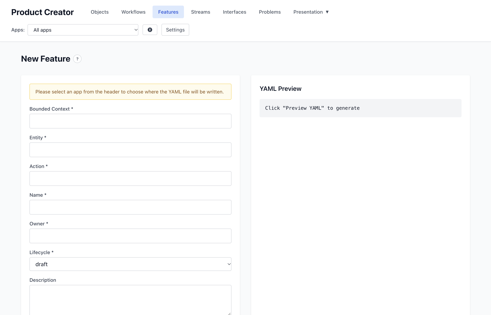
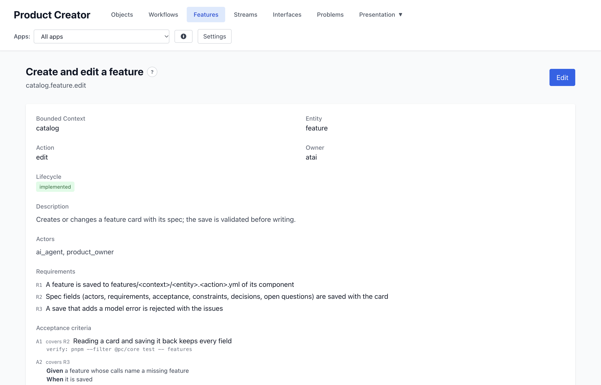
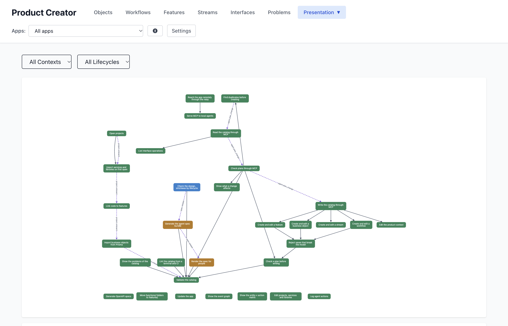
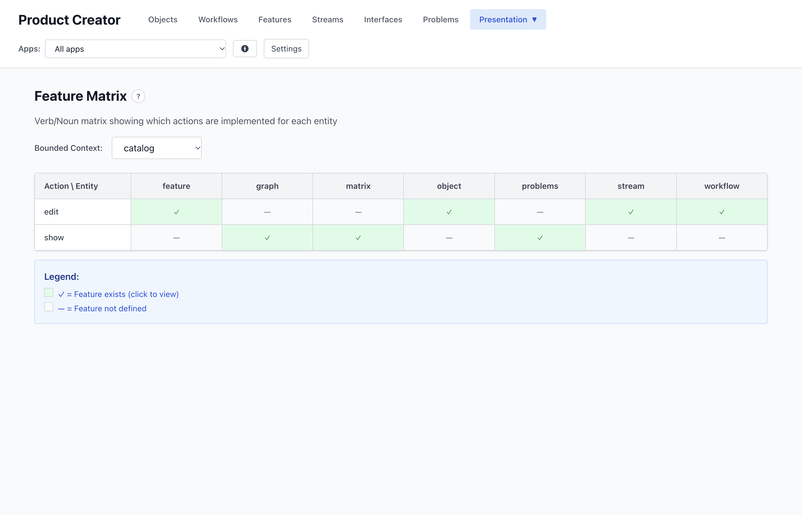
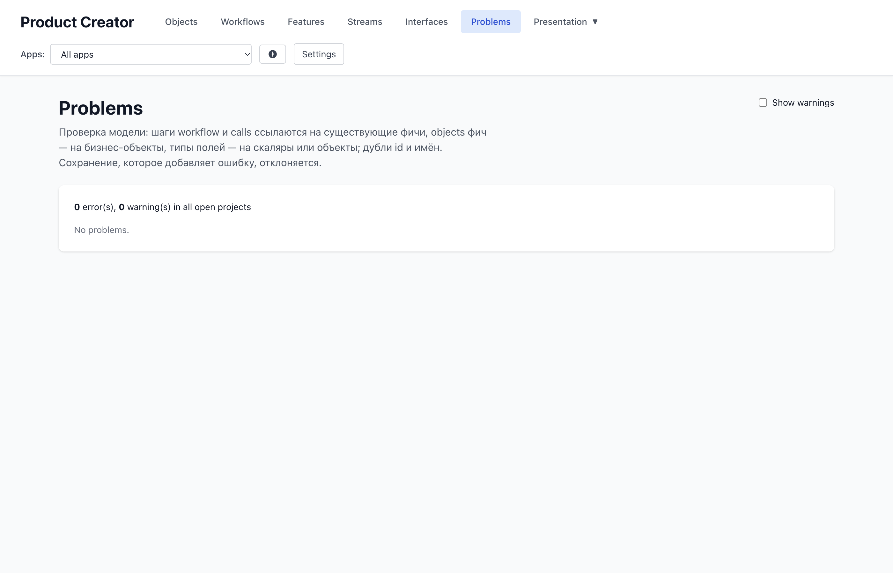
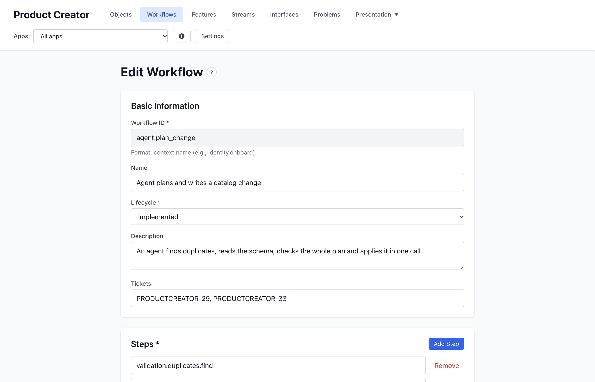
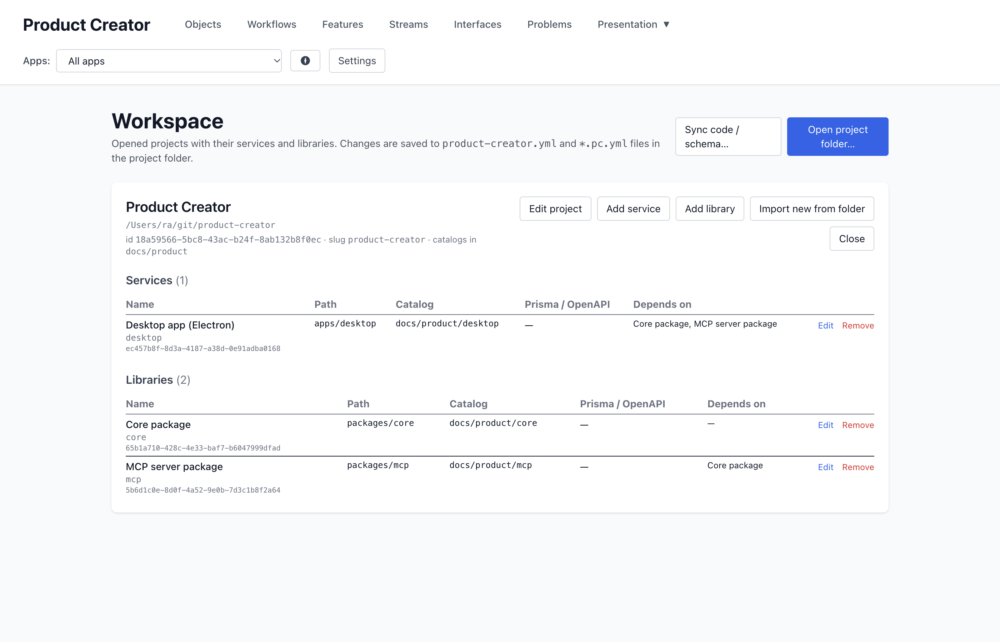
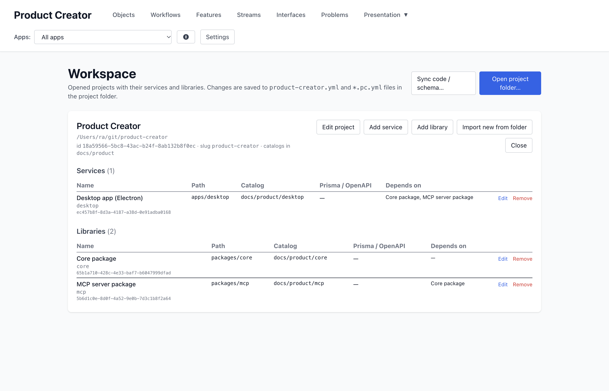
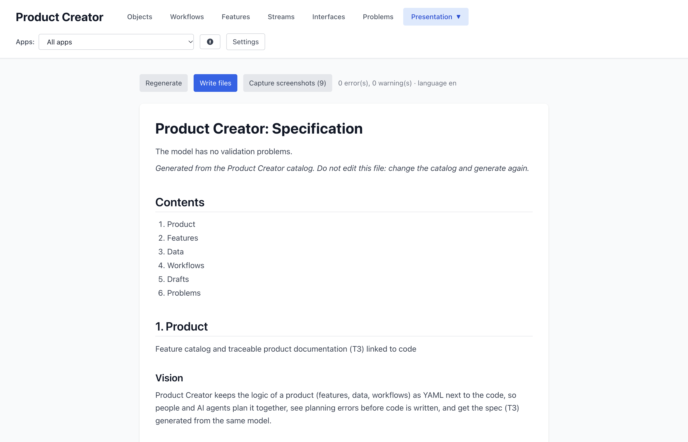

# Product Creator: Specification

The model has no validation problems.

*Generated from the Product Creator catalog. Do not edit this file: change the catalog and generate again.*

## Contents

1. Product
2. Features
3. Data
4. Workflows
5. Drafts
6. Problems

## 1. Product

Feature catalog and traceable product documentation (ТЗ) linked to code

### Vision

Product Creator keeps the logic of a product (features, data, workflows) as YAML next to the code, so people and AI agents plan it together, see planning errors before code is written, and get the spec (ТЗ) generated from the same model.

### Goals

- **G1** Planning and design errors are visible to people and agents as soon as they are written: in the editor, through MCP and in CI
- **G2** Specs for people and for agents are generated from one model and never written twice
- **G3** Every feature is traceable to its code, tickets and tests
- **G4** Agents plan and change the catalog safely through MCP

### Actors

| Actor | Description |
| --- | --- |
| Product owner | Plans features, approves specs |
| Developer | Builds features, links code, runs sync |
| AI agent | Reads and changes the catalog through MCP, locally or through the relay |
| CI | Checks the catalog on every push |
| Client | Reads the human spec |

### Glossary

| Term | Definition |
| --- | --- |
| Feature | A business capability of the product (formerly function); one YAML file with its spec and links to code |
| Business object | A data entity of the product with typed fields |
| Workflow | An ordered sequence of features with compensations |
| Component | A service or library of a project; each has its own catalog folder |
| Catalog | The YAML files of features, business objects and workflows of a component |
| Lifecycle | draft → approved → implemented → deprecated → removed; each status has its own rules |
| Plan | A set of proposed catalog changes, checked as a whole before anything is written |
| Spec (ТЗ) | The document generated from the model: a human view and an agent bundle |

## 2. Features

### app

#### Update the app (`app.update.install`)

*implemented* · Component: Desktop app (Electron) · Tickets: [PRODUCTCREATOR-21](https://ecooz.youtrack.cloud/issue/PRODUCTCREATOR-21)

Signed releases update automatically; a check can be started from the menu.

**Actors:** Product owner

**Requirements**

- **R1** Updates are installed only for signed builds

### catalog

#### Create and edit a feature (`catalog.feature.edit`)

*implemented* · Component: Core package · Tickets: [PRODUCTCREATOR-7](https://ecooz.youtrack.cloud/issue/PRODUCTCREATOR-7), [PRODUCTCREATOR-32](https://ecooz.youtrack.cloud/issue/PRODUCTCREATOR-32)

Creates or changes a feature card with its spec; the save is validated before writing.

**Actors:** AI agent, Product owner

**Requirements**

- **R1** A feature is saved to features/<context>/<entity>.<action>.yml of its component
- **R2** Spec fields (actors, requirements, acceptance, constraints, decisions, open questions) are saved with the card
- **R3** A save that adds a model error is rejected with the issues

**Acceptance criteria**

- **A1** (covers R2): Reading a card and saving it back keeps every field
- **A2** (covers R3): **Given** a feature whose calls name a missing feature; **When** it is saved; **Then** the response is 400 with unknown_feature

**Screens**

*S1 — New feature form: links and spec*

*S2 — A feature page with its spec, tickets and impact*

**Business objects:** `feature` (write)

#### Show the event graph (`catalog.graph.show`)

*implemented* · Component: Desktop app (Electron) · Tickets: [PRODUCTCREATOR-7](https://ecooz.youtrack.cloud/issue/PRODUCTCREATOR-7)

Features connected by emitted and consumed events, coloured by lifecycle.

**Screens**

*S1 — Feature graph: calls, workflow steps and events*

**Business objects:** `feature` (read)

#### Show the entity × action matrix (`catalog.matrix.show`)

*implemented* · Component: Desktop app (Electron) · Tickets: [PRODUCTCREATOR-7](https://ecooz.youtrack.cloud/issue/PRODUCTCREATOR-7)

Entity × action coverage per bounded context.

**Screens**

*S1 — Entity × action matrix*

**Business objects:** `feature` (read)

#### Create and edit a business object (`catalog.object.edit`)

*implemented* · Component: Core package · Tickets: [PRODUCTCREATOR-7](https://ecooz.youtrack.cloud/issue/PRODUCTCREATOR-7)

Creates or changes a business object with its fields; field types are scalars or other business objects.

**Requirements**

- **R1** A field type is a scalar (string, int, uuid, enum<a\|b>, …) or an existing business object

**Acceptance criteria**

- **A1** (covers R1): A field of unknown type is rejected with unknown_type

**Business objects:** `business_object` (write)

#### Show the problems of the catalog (`catalog.problems.show`)

*implemented* · Component: Desktop app (Electron) · Tickets: [PRODUCTCREATOR-29](https://ecooz.youtrack.cloud/issue/PRODUCTCREATOR-29)

The Problems page lists validation errors and warnings with links to the entries.

**Actors:** Product owner

**Requirements**

- **R1** Errors and warnings are grouped by entry and link to it

**Screens**

*S1 — Problems of the catalog*

**Business objects:** `validation_issue` (read)

#### Create and edit a stream (`catalog.stream.edit`)

*implemented* · Component: Core package · Tickets: [PRODUCTCREATOR-7](https://ecooz.youtrack.cloud/issue/PRODUCTCREATOR-7)

Creates or changes a stream: a business process with stages, KPIs and workflows per stage.

**Requirements**

- **R1** Streams are saved as YAML in streams/

**Open questions**

- **Q1** Streams are not validated and not used by any other entity: keep, validate, or drop them? — atai

#### Create and edit a workflow (`catalog.workflow.edit`)

*implemented* · Component: Core package · Tickets: [PRODUCTCREATOR-7](https://ecooz.youtrack.cloud/issue/PRODUCTCREATOR-7), [PRODUCTCREATOR-33](https://ecooz.youtrack.cloud/issue/PRODUCTCREATOR-33)

Creates or changes a workflow: ordered steps (features) with compensations.

**Requirements**

- **R1** Every step and compensation is an existing feature

**Acceptance criteria**

- **A1** (covers R1): A step that is not a feature is rejected with unknown_feature

**Screens**

*S1 — Workflow form with lifecycle and steps*

**Business objects:** `workflow` (write)

### interfaces

#### Generate OpenAPI specs (`interfaces.openapi.generate`)

*implemented* · Component: Core package · Tickets: [PRODUCTCREATOR-23](https://ecooz.youtrack.cloud/issue/PRODUCTCREATOR-23)

Runs the OpenAPI generate command of a component and reloads its operations.

**Requirements**

- **R1** The command runs in the component folder with the login shell PATH
- **R2** One generation per component at a time; it can be cancelled

**Acceptance criteria**

- **A1** (covers R2): The manager runs, deduplicates and cancels generations

**Business objects:** `component` (read), `interface_operation` (write)

#### List interface operations (`interfaces.operation.list`)

*implemented* · Component: Core package · Tickets: [PRODUCTCREATOR-9](https://ecooz.youtrack.cloud/issue/PRODUCTCREATOR-9)

Loads committed or generated OpenAPI specs and lists their operations (Interfaces page, MCP).

**Requirements**

- **R1** Operations are addressed as <componentId>#<METHOD> <path>

**Acceptance criteria**

- **A1** (covers R1): YAML and JSON specs load into operations

**Business objects:** `interface_operation` (read)

### mcp

#### Log agent actions (`mcp.actions.log`)

*implemented* · Component: MCP server package · Tickets: [PRODUCTCREATOR-18](https://ecooz.youtrack.cloud/issue/PRODUCTCREATOR-18)

Every tool call is recorded with compacted arguments and shown in the app.

**Requirements**

- **R1** Every tool call, local or relayed, is recorded

**Business objects:** `action_log_entry` (write)

#### Read the catalog through MCP (`mcp.catalog.read`)

*implemented* · Component: MCP server package · Tickets: [PRODUCTCREATOR-18](https://ecooz.youtrack.cloud/issue/PRODUCTCREATOR-18), [PRODUCTCREATOR-32](https://ecooz.youtrack.cloud/issue/PRODUCTCREATOR-32), [PRODUCTCREATOR-33](https://ecooz.youtrack.cloud/issue/PRODUCTCREATOR-33)

list_projects, get_project, list_components, list_catalog, get_catalog_entry, get_schema, get_object, list_interfaces.

**Actors:** AI agent

**Requirements**

- **R1** An agent can read the schema of a card before writing it
- **R2** Lists are compact and paged

**Acceptance criteria**

- **A1** (covers R1): get_schema(feature) lists the spec fields

**Business objects:** `feature` (read), `business_object` (read), `workflow` (read)

#### Write the catalog through MCP (`mcp.catalog.write`)

*implemented* · Component: MCP server package · Tickets: [PRODUCTCREATOR-18](https://ecooz.youtrack.cloud/issue/PRODUCTCREATOR-18), [PRODUCTCREATOR-33](https://ecooz.youtrack.cloud/issue/PRODUCTCREATOR-33)

apply_plan, create_catalog_entry, update_catalog_entry, update_project; writes are validated and rejected with issues.

**Actors:** AI agent

**Requirements**

- **R1** A write that adds model errors is rejected with the issues
- **R2** update merges a patch at the top level; null removes a field
- **R3** apply_plan writes a whole plan at once: entries may reference each other, nothing is written if the plan adds errors, a failed write is rolled back
- **R4** A read-only session is told which setting enables writing

**Acceptance criteria**

- **A1** (covers R1): Creating a feature with an unknown object returns unknown_object
- **A2** (covers R3): A plan with cross-references is applied in one call; a broken plan writes nothing
- **A3** (covers R4): Read-only server instructions name Settings → MCP → scope

#### Check plans through MCP (`mcp.plan.check`)

*implemented* · Component: MCP server package · Tickets: [PRODUCTCREATOR-29](https://ecooz.youtrack.cloud/issue/PRODUCTCREATOR-29)

validate_catalog, validate_plan, impact_of_change, find_duplicates for agents.

**Actors:** AI agent

**Requirements**

- **R1** An agent checks a whole plan in one call before writing code

#### Reach the app remotely through the relay (`mcp.relay.connect`)

*implemented* · Component: MCP server package · Tickets: [PRODUCTCREATOR-20](https://ecooz.youtrack.cloud/issue/PRODUCTCREATOR-20), [PRODUCTCREATOR-25](https://ecooz.youtrack.cloud/issue/PRODUCTCREATOR-25), [PRODUCTCREATOR-27](https://ecooz.youtrack.cloud/issue/PRODUCTCREATOR-27)

Remote agents reach the local MCP server through the Emperor relay; scope is the stricter of the bot token and the local setting.

**Actors:** AI agent

**Requirements**

- **R1** The effective scope is the stricter of the relay token and the local setting
- **R2** Empty or typeless local responses are passed as 204

**Acceptance criteria**

- **A1** (covers R1, R2): Handshake, scope and relayed requests behave as specified

**Business objects:** `mcp_settings` (read)

#### Serve MCP to local agents (`mcp.server.serve`)

*implemented* · Component: MCP server package · Tickets: [PRODUCTCREATOR-18](https://ecooz.youtrack.cloud/issue/PRODUCTCREATOR-18)

Streamable HTTP MCP server on 127.0.0.1 with a bearer token and read or write scope; off by default.

**Actors:** AI agent

**Requirements**

- **R1** Only 127.0.0.1 is listened on
- **R2** Requests without the token are rejected
- **R3** Read scope cannot call write tools

**Acceptance criteria**

- **A1** (covers R2, R3): Wrong token → 401; write tool with read token → error

**Constraints**

- **C1** *security* The token is stored only in the app data folder (mode 0600)

**Business objects:** `mcp_settings` (read)

### project

#### Move functions/ folders to features/ (`project.catalog.migrate`)

*implemented* · Component: Core package · Tickets: [PRODUCTCREATOR-28](https://ecooz.youtrack.cloud/issue/PRODUCTCREATOR-28)

Moves the old functions/ catalog folders to features/ without overwriting anything (app banner and `product-creator migrate`).

**Requirements**

- **R1** Files move from functions/ to features/ of every component
- **R2** A file with different content in features/ is a conflict: it stays and is reported

**Acceptance criteria**

- **A1** (covers R1, R2): migrate moves files, removes identical copies and reports conflicts

**Business objects:** `feature` (write)

#### Edit projects, services and libraries (`project.component.edit`)

*implemented* · Component: Desktop app (Electron) · Tickets: [PRODUCTCREATOR-12](https://ecooz.youtrack.cloud/issue/PRODUCTCREATOR-12), [PRODUCTCREATOR-14](https://ecooz.youtrack.cloud/issue/PRODUCTCREATOR-14)

Edits the project and its components in the app; the YAML files are the database.

**Requirements**

- **R1** Name, paths, dependencies and the OpenAPI command of a component can be edited
- **R2** Saving keeps the UUID of the component

**Acceptance criteria**

- **A1** (covers R2): Renaming a component keeps its id

**Screens**

*S1 — Projects, services and libraries in the workspace*

**Business objects:** `project` (write), `component` (write)

#### Edit the product context (`project.context.edit`)

*implemented* · Component: Desktop app (Electron)

Vision, goals, actors, glossary and tracker of a project, stored in product-creator.yml: the first part of a spec.

**Actors:** AI agent, Product owner

**Requirements**

- **R1** Vision, goals (G1…), actors, glossary and tracker are saved in product-creator.yml and survive other project edits
- **R2** Goal ids, actor ids and glossary terms are unique; actor ids use a-z, 0-9, _; the tracker URL contains {id}
- **R3** An agent reads the context with get_project and changes it with update_project
- **R4** Ticket keys of entries link to the tracker

**Acceptance criteria**

- **A1** (covers R1, R2): updateProject saves, keeps and clears the context and rejects bad ids
- **A2** (covers R3): get_project returns what update_project wrote; a bad goal id is rejected

**Screens**

*S1 — Workspace with the project and its components*

**Business objects:** `project` (write)

#### Import services and libraries on first open (`project.layout.import`)

*implemented* · Component: Core package · Tickets: [PRODUCTCREATOR-8](https://ecooz.youtrack.cloud/issue/PRODUCTCREATOR-8), [PRODUCTCREATOR-12](https://ecooz.youtrack.cloud/issue/PRODUCTCREATOR-12), [PRODUCTCREATOR-13](https://ecooz.youtrack.cloud/issue/PRODUCTCREATOR-13)

When a repository is opened for the first time, services and libraries are found from its layout and written to product-creator.yml and *.pc.yml.

**Actors:** Product owner

**Requirements**

- **R1** Services and libraries are discovered from the repository layout (apps/, packages/, …)
- **R2** Ids are UUIDs that never change after the import
- **R3** Later opens read the YAML files and do not import again

**Acceptance criteria**

- **A1** (covers R1, R2): **Given** a monorepo opened for the first time; **When** the import runs; **Then** product-creator.yml and one *.pc.yml per component exist with UUIDs
- **A2** (covers R3): Reopening the folder changes no file

**Business objects:** `project` (write), `component` (write)

#### Open projects (`project.workspace.open`)

*implemented* · Component: Desktop app (Electron) · Tickets: [PRODUCTCREATOR-6](https://ecooz.youtrack.cloud/issue/PRODUCTCREATOR-6), [PRODUCTCREATOR-9](https://ecooz.youtrack.cloud/issue/PRODUCTCREATOR-9)

Opens one or several project folders: from the command line, from the current folder or from the Workspace page.

**Actors:** Developer, Product owner

**Requirements**

- **R1** `product-creator` opens the current folder; folders given as arguments open together
- **R2** The Workspace page adds and removes projects

**Acceptance criteria**

- **A1** (covers R1): `product-creator ~/a ~/b` shows both projects in the workspace

**Open questions**

- **Q1** Should the workspace remember projects between launches per machine or per user? — atai

**Business objects:** `project` (read)

### sync

#### Link code to features (`sync.code.link`)

*implemented* · Component: Core package · Tickets: [PRODUCTCREATOR-4](https://ecooz.youtrack.cloud/issue/PRODUCTCREATOR-4), [PRODUCTCREATOR-30](https://ecooz.youtrack.cloud/issue/PRODUCTCREATOR-30)

Code sync matches exported code functions to existing features: linked / proposed / candidate / stale. Creates a feature only on request.

**Actors:** AI agent, Developer

**Requirements**

- **R1** A matched code function proposes a link that sets source_file and calls
- **R2** An unmatched code function is a candidate; nothing is created by default
- **R3** A feature whose code is gone is stale; it is never marked removed automatically

**Acceptance criteria**

- **A1** (covers R1, R2, R3): Matching yields linked, proposed, candidate and stale items

**Open questions**

- **Q1** Should sync refresh calls of linked features on every run, or only on link? — atai

**Business objects:** `feature` (write), `code_link` (write)

#### Import business objects from Prisma (`sync.schema.import`)

*implemented* · Component: Core package · Tickets: [PRODUCTCREATOR-3](https://ecooz.youtrack.cloud/issue/PRODUCTCREATOR-3)

Schema sync creates and updates business objects from a Prisma schema.

**Requirements**

- **R1** Models become business objects with fields and tables
- **R2** Prisma enums become field types that validation accepts

**Acceptance criteria**

- **A1** (covers R1): A Prisma schema is parsed into models and fields

**Open questions**

- **Q1** Model a Prisma enum as a business object kind or as enum<…> field types? — atai

**Business objects:** `business_object` (write)

### validation

#### Lint the catalog from a terminal and CI (`validation.catalog.lint`)

*implemented* · Component: Desktop app (Electron) · Tickets: [PRODUCTCREATOR-29](https://ecooz.youtrack.cloud/issue/PRODUCTCREATOR-29), [PRODUCTCREATOR-33](https://ecooz.youtrack.cloud/issue/PRODUCTCREATOR-33)

`product-creator lint` validates the catalogs of a project; exit code 1 on errors. CI runs it on this repo.

**Actors:** CI, Developer

**Requirements**

- **R1** Exit code is 1 when there are errors
- **R2** --json prints the issues for tools
- **R3** CI fails when this repo's catalog has errors

**Acceptance criteria**

- **A1** (covers R3): pnpm catalog:lint is a CI step

#### Show what a change affects (`validation.change.impact`)

*implemented* · Component: Core package · Tickets: [PRODUCTCREATOR-29](https://ecooz.youtrack.cloud/issue/PRODUCTCREATOR-29)

For a business object or feature: the features that use or call it, their callers, workflows and objects with fields of its type.

**Requirements**

- **R1** Impact of an object lists features by access and the workflows that use them
- **R2** Impact of a feature lists callers two levels up

**Acceptance criteria**

- **A1** (covers R1, R2): impactOf returns features, workflows and objects with the reason (via)

**Business objects:** `feature` (read), `business_object` (read), `workflow` (read)

#### Check the design, strictness by lifecycle (`validation.design.check`)

*approved* · Component: Core package · Tickets: [PRODUCTCREATOR-34](https://ecooz.youtrack.cloud/issue/PRODUCTCREATOR-34)

Design-level checks: architecture (calls vs dependsOn, cycles), events, object usage, lifecycle consistency, completeness, code links. Warnings in draft, errors from approved on.

**Actors:** AI agent, CI, Product owner

**Requirements**

- **R1** A feature calling a feature of a component it does not depend on is an error
- **R2** An approved feature without requirements, with a requirement not covered by acceptance, or with open questions is an error
- **R3** An approved feature calling a draft feature is an error
- **R4** An implemented feature without an existing source_file is an error
- **R5** References to removed entries are errors; new references to deprecated ones are warnings
- **R6** In draft every design problem is a warning

**Acceptance criteria**

- **A1** (covers R2, R6): **Given** the same incomplete feature; **When** it is draft, then approved; **Then** the problem is a warning, then an error
- **A2** (covers R1): A core feature calling a desktop feature is reported (core does not depend on desktop)

**Decisions**

- **D1** Strictness depends on lifecycle — Drafting is never blocked; agreed work must be complete (2026-11-28)

#### Find duplicates before creating (`validation.duplicates.find`)

*implemented* · Component: Core package · Tickets: [PRODUCTCREATOR-29](https://ecooz.youtrack.cloud/issue/PRODUCTCREATOR-29)

Finds entries with the same or a similar name or id.

**Actors:** AI agent

**Requirements**

- **R1** Similar names and ids are found across components

#### Validate the catalog (`validation.model.validate`)

*implemented* · Component: Core package · Tickets: [PRODUCTCREATOR-29](https://ecooz.youtrack.cloud/issue/PRODUCTCREATOR-29), [PRODUCTCREATOR-32](https://ecooz.youtrack.cloud/issue/PRODUCTCREATOR-32)

Checks the whole model: schemas, ids, references, field types, duplicates, spec items. One implementation for the UI, MCP and CLI.

**Actors:** AI agent, CI, Product owner

**Requirements**

- **R1** References of calls, objects, steps and compensations resolve across all loaded projects
- **R2** Every issue names the entry, the field and a message a person understands
- **R3** Streams are validated too *(should)*

**Acceptance criteria**

- **A1** (covers R1, R2): A catalog with unknown references, types and duplicates reports each with code and field

**Constraints**

- **C1** *performance* Validating a catalog of 1000 entries takes under 1 s

**Business objects:** `feature` (read), `business_object` (read), `workflow` (read), `validation_issue` (write)

#### Check a plan before writing (`validation.plan.check`)

*implemented* · Component: Core package · Tickets: [PRODUCTCREATOR-29](https://ecooz.youtrack.cloud/issue/PRODUCTCREATOR-29)

Applies proposed upserts and deletes to a copy of the model and reports only the errors the plan introduces.

**Actors:** AI agent

**Requirements**

- **R1** Nothing is written
- **R2** Only errors introduced by the plan make ok false; existing problems are reported separately

**Acceptance criteria**

- **A1** (covers R1, R2): **Given** a plan with a workflow step that does not exist; **When** validate_plan runs; **Then** ok is false, introduced has unknown_feature, no file changed

**Decisions**

- **D1** Plan checks apply changes to a copy of the snapshot — One validation for real and planned state; no second implementation (2026-11-20)

#### Reject saves that break the model (`validation.save.guard`)

*implemented* · Component: Core package · Tickets: [PRODUCTCREATOR-29](https://ecooz.youtrack.cloud/issue/PRODUCTCREATOR-29)

Every save (UI, MCP) is checked before and after the change; it is rejected only if it adds an error.

**Requirements**

- **R1** A catalog that already has problems stays editable
- **R2** The rejection lists the introduced issues

**Acceptance criteria**

- **A1** (covers R1, R2): Writes that add errors are rejected, consistent ones accepted, existing problems stay editable

## 3. Data

### Action log entry (`action_log_entry`)

*implemented* · Component: Core package

One MCP tool call recorded in the action log

| Field | Type | Description |
| --- | --- | --- |
| at | `datetime` |  |
| tool | `string` |  |
| args | `json` | Compacted arguments |
| ok | `boolean` |  |
| caller | `enum<local\|relay>` |  |

**Used by:** Log agent actions (write)

### Business object (`business_object`)

*implemented* · Component: Core package

A data entity of the product: business-objects/<id>.yml

| Field | Type | Description |
| --- | --- | --- |
| id | `string` |  |
| name | `string` |  |
| lifecycle | `enum<draft\|approved\|implemented\|deprecated\|removed>` |  |
| fields | `json` | name, type, description |
| tables | `json?` | Physical tables (from Prisma) |

**Used by:** Create and edit a business object (write), Read the catalog through MCP (read), Import business objects from Prisma (write), Show what a change affects (read), Validate the catalog (read)

### Code link (`code_link`)

*implemented* · Component: Core package

Link of a code function to a feature: .sync-mapping.json of a catalog

| Field | Type | Description |
| --- | --- | --- |
| codeFunction | `string` | <file>:<function> |
| feature | `feature` |  |
| status | `enum<linked\|proposed\|candidate\|stale>` |  |
| lastSync | `datetime` |  |

**Used by:** Link code to features (write)

### Component (`component`)

*implemented* · Component: Core package

A service or library of a project; <catalog>/service.pc.yml or library.pc.yml

| Field | Type | Description |
| --- | --- | --- |
| id | `uuid` |  |
| kind | `enum<service\|library>` |  |
| slug | `string` |  |
| name | `string` |  |
| path | `string` | Code folder |
| codeBasePath | `string?` | Base of source_file paths |
| catalog | `string` | Catalog folder |
| dependsOn | `component[]` |  |
| openapiGenerate | `string?` | Command that writes the OpenAPI spec |

**Used by:** Generate OpenAPI specs (read), Edit projects, services and libraries (write), Import services and libraries on first open (write)

### Feature (`feature`)

*implemented* · Component: Core package

A business capability: features/<context>/<entity>.<action>.yml

| Field | Type | Description |
| --- | --- | --- |
| id | `string` | <bounded_context>.<entity>.<action> |
| name | `string` |  |
| lifecycle | `enum<draft\|approved\|implemented\|deprecated\|removed>` |  |
| description | `text?` |  |
| calls | `feature[]` |  |
| objects | `business_object[]` | With access read \| write |
| source_file | `string?` |  |
| actors | `string[]` |  |
| requirements | `json` |  |
| acceptance | `json` |  |
| constraints | `json` |  |
| decisions | `json` |  |
| open_questions | `json` |  |
| code_refs | `json` | component, file, symbol, role |
| tickets | `string[]` |  |

**Used by:** Create and edit a feature (write), Show the event graph (read), Show the entity × action matrix (read), Read the catalog through MCP (read), Move functions/ folders to features/ (write), Link code to features (write), Show what a change affects (read), Validate the catalog (read)

### Interface operation (`interface_operation`)

*implemented* · Component: Core package

An operation of a component's OpenAPI spec

| Field | Type | Description |
| --- | --- | --- |
| ref | `string` | <componentId>#<METHOD> <path> |
| method | `enum<GET\|POST\|PUT\|PATCH\|DELETE>` |  |
| path | `string` |  |
| component | `component` |  |

**Used by:** Generate OpenAPI specs (write), List interface operations (read)

### MCP settings (`mcp_settings`)

*implemented* · Component: Core package

settings.json in the app data folder

| Field | Type | Description |
| --- | --- | --- |
| enabled | `boolean` |  |
| scope | `enum<read\|write>` |  |
| port | `int` |  |
| token | `string` | Bearer token |
| relayEnabled | `boolean` |  |

**Used by:** Reach the app remotely through the relay (read), Serve MCP to local agents (read)

### Project (`project`)

*implemented* · Component: Core package

A repository opened in Product Creator; product-creator.yml at its root

| Field | Type | Description |
| --- | --- | --- |
| id | `uuid` | Stable id, never changes |
| slug | `string` |  |
| name | `string` |  |
| description | `text?` |  |
| catalogRoot | `string` | Folder of the component catalogs, e.g. docs/product |
| components | `component[]` |  |
| vision | `text?` |  |
| goals | `json` | G1… with text |
| actors | `json` | id, name, description |
| glossary | `json` |  |
| tracker | `json?` | issueUrl with {id} |

**Used by:** Edit projects, services and libraries (write), Edit the product context (write), Import services and libraries on first open (write), Open projects (read)

### Validation issue (`validation_issue`)

*implemented* · Component: Core package

A problem of the model found by validation (not stored; computed)

| Field | Type | Description |
| --- | --- | --- |
| severity | `enum<error\|warning>` |  |
| code | `string` | e.g. unknown_feature, duplicate_item_id |
| kind | `enum<feature\|workflow\|business_object>` |  |
| id | `string` | Id of the entry with the problem |
| field | `string?` |  |
| message | `text` |  |
| file | `string?` |  |
| component | `component?` |  |

**Used by:** Show the problems of the catalog (read), Validate the catalog (write)

### Workflow (`workflow`)

*implemented* · Component: Core package

An ordered sequence of features: workflows/<key>.yml

| Field | Type | Description |
| --- | --- | --- |
| workflow | `string` | <context>.<name> |
| name | `string?` |  |
| steps | `feature[]` |  |
| compensations | `json?` |  |
| lifecycle | `enum<draft\|approved\|implemented\|deprecated\|removed>` |  |
| description | `text?` |  |
| tickets | `string[]` |  |

**Used by:** Create and edit a workflow (write), Read the catalog through MCP (read), Show what a change affects (read), Validate the catalog (read)

## 4. Workflows

### Agent plans and writes a catalog change (`agent.plan_change`)

*implemented*

Tickets: [PRODUCTCREATOR-29](https://ecooz.youtrack.cloud/issue/PRODUCTCREATOR-29), [PRODUCTCREATOR-33](https://ecooz.youtrack.cloud/issue/PRODUCTCREATOR-33)

An agent finds duplicates, reads the schema, checks the whole plan and applies it in one call.

**Steps**

1. Find duplicates before creating (`validation.duplicates.find`)
2. Read the catalog through MCP (`mcp.catalog.read`)
3. Check plans through MCP (`mcp.plan.check`)
4. Write the catalog through MCP (`mcp.catalog.write`)

### Onboard a repository (`project.onboard`)

*implemented*

Tickets: [PRODUCTCREATOR-8](https://ecooz.youtrack.cloud/issue/PRODUCTCREATOR-8), [PRODUCTCREATOR-30](https://ecooz.youtrack.cloud/issue/PRODUCTCREATOR-30)

A repository is opened, its components imported, code and Prisma linked, and the catalog validated.

**Steps**

1. Open projects (`project.workspace.open`)
2. Import services and libraries on first open (`project.layout.import`)
3. Link code to features (`sync.code.link`)
4. Import business objects from Prisma (`sync.schema.import`)
5. Validate the catalog (`validation.model.validate`)

### Release a spec (`spec.release`)

*draft*

Tickets: [PRODUCTCREATOR-34](https://ecooz.youtrack.cloud/issue/PRODUCTCREATOR-34), [PRODUCTCREATOR-35](https://ecooz.youtrack.cloud/issue/PRODUCTCREATOR-35)

Design checks pass, then the agent bundle and the human spec are generated.

**Steps**

1. Check the design, strictness by lifecycle (`validation.design.check`)
2. Generate the agent spec bundle (`spec.bundle.generate`)
3. Render the spec for people (`spec.document.render`)

## 5. Drafts

*Not agreed yet: these features may still change.*

### spec

#### Generate the agent spec bundle (`spec.bundle.generate`)

*draft* · Component: Core package · Tickets: [PRODUCTCREATOR-35](https://ecooz.youtrack.cloud/issue/PRODUCTCREATOR-35)

Manifest and small chunks per feature, component and interface group, with ids, contracts, objects, acceptance with verify and code anchors.

**Actors:** AI agent

**Requirements**

- **R1** Unresolved validation issues are part of the bundle next to the affected feature
- **R2** Fields marked x-audience: human are left out

**Open questions**

- **Q1** Scope of a bundle: whole product, component, or a selected set of features? — atai
- **Q2** Size budget per chunk? — atai

#### Render the spec for people (`spec.document.render`)

*draft* · Component: Desktop app (Electron) · Tickets: [PRODUCTCREATOR-19](https://ecooz.youtrack.cloud/issue/PRODUCTCREATOR-19), [PRODUCTCREATOR-35](https://ecooz.youtrack.cloud/issue/PRODUCTCREATOR-35)

The Doc page renders the human spec (ТЗ) from the model and exports Markdown/HTML/PDF.

**Actors:** Client, Product owner

**Requirements**

- **R1** A spec with errors says so on top
- **R2** Problems are shown next to the affected feature
- **R3** Fields marked x-audience: agent are left out

**Open questions**

- **Q1** Language of the human spec: one per project, or Russian for people and English for agents? — atai

**Screens**

*S1 — The generated spec on the Doc page*

## 6. Problems

The model has no validation problems.
